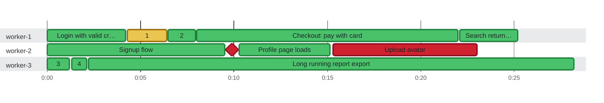

### Timeline

**11** tests (and **1** run before a retry) on **3** threads in **28.2s** · busy **89%** of the time · up to **3** at once Slowest and last to finish: `Long running report export` (26.0s on `worker-3`, until 0:28.200)

🟩 passed · 🟥 failed · 🟨 failed, then retried (dashed) · ♦️ failed too fast for a bar · 0:00 = 2026-10-21 08:16:56.000 UTC
 1 skipped or pending test is not shown.
 A number on a bar is the row with that number (#) in the test timings below.

| Thread | Tests | Runs before a retry | Failed | Busy | Idle | Utilization |
| :--- | ---: | ---: | ---: | ---: | ---: | ---: |
| worker-1 | 4 | 1 | 0 | 24.9s | 3.3s | 88% |
| worker-2 | 4 | 0 | 2 | 22.7s | 5.5s | 80% |
| worker-3 | 3 | 0 | 0 | 28.0s | 200ms | 99% |

Test timings (12)

| # | Start | Duration | Thread | Test | Status |
| ---: | ---: | ---: | :--- | :--- | :--- |
|  | 0:00.000 | 4.2s | worker-1 | Login with valid credentials | ✅ passed |
| 1 | 0:04.300 | 2.1s | worker-1 | Login retry (attempt 1) | ❌ failed |
| 2 | 0:06.450 | 1.5s | worker-1 | Login retry | ✅ passed |
|  | 0:08.000 | 14.0s | worker-1 | Checkout: pay with card | ✅ passed |
|  | 0:22.100 | 3.1s | worker-1 | Search returns results | ✅ passed |
|  | 0:00.000 | 9.8s | worker-2 | Signup flow | ✅ passed |
|  | 0:09.900 | 0ms | worker-2 | Init fails fast | ❌ failed |
|  | 0:09.950 | 5.2s | worker-2 | Profile page loads | ✅ passed |
|  | 0:15.300 | 7.7s | worker-2 | Upload avatar | ❌ failed |
| 3 | 0:00.000 | 1.2s | worker-3 | Cart persists after reload | ✅ passed |
| 4 | 0:01.300 | 800ms | worker-3 | Cart badge count | ✅ passed |
|  | 0:02.200 | 26.0s | worker-3 | Long running report export | ✅ passed |

