### Timeline

```mermaid
---
config:
  gantt:
    displayMode: compact
    useWidth: 1000
    leftPadding: 124
    rightPadding: 40
  themeCSS: ".taskText.critText0,.taskText.critText1,.taskText.critText2,.taskText.critText3{fill:#ffffff !important}.active0,.active1,.active2,.active3{stroke-dasharray:4 2}"
  themeVariables:
    taskBkgColor: '#4ac26b'
    taskBorderColor: '#1a7f37'
    critBkgColor: '#cf222e'
    critBorderColor: '#82071e'
    activeTaskBkgColor: '#eac54f'
    activeTaskBorderColor: '#9a6700'
    doneTaskBkgColor: '#afb8c1'
    doneTaskBorderColor: '#6e7781'
    taskTextColor: '#1f2328'
    taskTextDarkColor: '#1f2328'
    sectionBkgColor: '#8c959f'
    sectionBkgColor2: '#8c959f'
    vertLineColor: '#8c959f'
---
gantt
accTitle: Test execution timeline
accDescr: 2250 tests on 8 threads over 4m 42s, 25 failed. The slowest test is pool-1-thread-7 test 1846 (7.8s on pool-1-thread-7). The last to finish is pool-1-thread-6 test 1713 on pool-1-thread-6, at 4:42.839.
dateFormat D HH:mm:ss.SSS
axisFormat %-M:%S
todayMarker off
section ​pool-1-thread-1
​ :16 00:00:00.000, 0ms
​ :16 00:00:00.165, 8142ms
​ :16 00:00:08.415, 2948ms
​32 tests :16 00:00:11.395, 30369ms
​ :16 00:00:41.815, 3307ms
​ :16 00:00:45.126, 6071ms
​ :16 00:00:51.252, 3882ms
​ :16 00:00:55.216, 7844ms
​ :16 00:01:03.062, 3267ms
​ :16 00:01:06.337, 18734ms
​ :16 00:01:25.120, 3137ms
​ :16 00:01:28.264, 3671ms
​ :16 00:01:31.966, 3170ms
​ :16 00:01:35.145, 204ms
​ :16 00:01:35.401, 3010ms
​ :crit, milestone, 16 00:01:42.471, 0ms
​ :16 00:01:46.530, 985ms
​ :16 00:01:47.554, 2850ms
​32 tests :16 00:01:50.410, 30604ms
​ :16 00:02:21.054, 3192ms
​ :16 00:02:24.261, 18288ms
​ :16 00:02:42.549, 5062ms
​ :16 00:02:47.626, 4395ms
​ :16 00:02:59.826, 5877ms
​ :16 00:03:05.722, 3293ms
​ :16 00:03:09.017, 454ms
​ :16 00:03:09.557, 5408ms
​ :16 00:03:14.980, 6421ms
​ :crit, milestone, 16 00:03:25.461, 0ms
​ :16 00:03:29.520, 2050ms
​ :16 00:03:31.726, 3972ms
​ :16 00:03:35.701, 5378ms
​ :16 00:03:41.094, 4402ms
​ :16 00:03:45.506, 7808ms
​ :16 00:03:53.335, 1178ms
​ :crit, milestone, 16 00:03:58.573, 0ms
​ :16 00:04:02.632, 3167ms
​ :16 00:04:05.825, 3071ms
​ :16 00:04:08.901, 3344ms
​ :16 00:04:12.247, 10460ms
​ :16 00:04:22.867, 2829ms
​ :16 00:04:25.703, 6960ms
​ :16 00:04:32.748, 4464ms
​ :16 00:04:37.232, 1677ms
​ :16 00:04:38.920, 3729ms
​ :16 00:04:42.839, 0ms
section ​pool-1-thread-2
​ :16 00:00:00.000, 17014ms
​ :crit, milestone, 16 00:00:21.074, 0ms
​ :16 00:00:25.204, 12006ms
​ :16 00:00:37.268, 4256ms
​ :16 00:00:41.528, 11199ms
​ :16 00:00:52.749, 112ms
​ :crit, milestone, 16 00:00:56.921, 0ms
​ :16 00:01:00.980, 3429ms
​ :16 00:01:04.418, 2725ms
​ :16 00:01:07.160, 7697ms
​ :16 00:01:14.877, 3207ms
​ :16 00:01:18.213, 16303ms
​ :16 00:01:34.912, 6030ms
​ :16 00:01:41.086, 5093ms
​ :16 00:01:46.211, 9323ms
​ :crit, milestone, 16 00:01:59.594, 0ms
​ :16 00:02:03.654, 8691ms
​ :16 00:02:12.351, 4449ms
​ :16 00:02:16.948, 16228ms
​ :crit, milestone, 16 00:02:37.249, 0ms
​32 tests :16 00:02:41.308, 25619ms
​ :16 00:03:06.941, 2803ms
​ :16 00:03:09.848, 8073ms
​ :16 00:03:17.942, 5399ms
​ :16 00:03:23.342, 3265ms
​ :16 00:03:26.687, 11637ms
​ :16 00:03:38.381, 4089ms
​ :16 00:03:42.578, 5025ms
​ :16 00:03:47.607, 4460ms
​ :16 00:03:52.142, 2101ms
​ :16 00:03:54.243, 4125ms
​ :16 00:03:58.382, 3433ms
​ :16 00:04:01.958, 2814ms
​ :16 00:04:04.783, 14471ms
​ :crit, milestone, 16 00:04:23.314, 0ms
​ :16 00:04:27.374, 2516ms
​ :16 00:04:29.987, 11450ms
section ​pool-1-thread-3
​ :16 00:00:00.367, 3855ms
​ :crit, milestone, 16 00:00:08.282, 0ms
​ :16 00:00:12.341, 7473ms
​ :crit, milestone, 16 00:00:23.874, 0ms
​ :16 00:00:27.933, 5461ms
​ :crit, milestone, 16 00:00:37.454, 0ms
​ :16 00:00:41.514, 311ms
​ :16 00:00:41.840, 3200ms
​ :16 00:00:45.120, 2943ms
​ :16 00:00:48.129, 1020ms
​ :16 00:00:49.163, 2753ms
​ :16 00:00:51.957, 6896ms
​ :16 00:00:58.909, 4210ms
​57 tests :16 00:01:03.123, 49034ms
​ :crit, milestone, 16 00:01:56.217, 0ms
​35 tests :16 00:02:00.277, 28375ms
​ :crit, 16 00:02:28.673, 5773ms
​29 tests :16 00:02:34.483, 25201ms
​ :16 00:02:59.787, 3203ms
​ :16 00:03:03.008, 6017ms
​ :16 00:03:09.046, 5641ms
​52 tests :16 00:03:14.769, 42136ms
​ :16 00:03:56.916, 3669ms
​ :16 00:04:00.623, 5718ms
​ :16 00:04:06.357, 5325ms
​ :16 00:04:11.708, 1789ms
​ :16 00:04:13.514, 3041ms
​ :16 00:04:16.609, 4906ms
​ :16 00:04:21.596, 2923ms
​ :16 00:04:24.635, 3115ms
​ :16 00:04:27.761, 9167ms
​ :16 00:04:36.936, 2851ms
​ :16 00:04:39.797, 853ms
section ​pool-1-thread-4
​ :crit, milestone, 16 00:00:01.974, 0ms
​ :16 00:00:06.033, 8297ms
​ :16 00:00:14.430, 5474ms
​21 tests :16 00:00:19.939, 21716ms
​ :crit, milestone, 16 00:00:45.715, 0ms
​ :16 00:00:49.774, 4924ms
​ :16 00:00:54.766, 3286ms
​ :16 00:00:58.101, 175ms
​ :16 00:00:58.288, 2786ms
​ :16 00:01:01.077, 12814ms
​ :16 00:01:13.906, 3371ms
​ :16 00:01:17.307, 6268ms
​ :16 00:01:30.017, 8549ms
​ :16 00:01:38.567, 3367ms
​ :16 00:01:41.935, 2917ms
​ :16 00:01:44.908, 3260ms
​ :16 00:01:48.176, 4452ms
​ :16 00:01:59.064, 8858ms
​ :16 00:02:07.979, 4650ms
​21 tests :16 00:02:12.641, 20459ms
​ :16 00:02:39.225, 7366ms
​35 tests :16 00:02:51.234, 27208ms
​ :16 00:03:18.455, 3072ms
​ :16 00:03:21.548, 16313ms
​ :16 00:03:43.700, 10014ms
​ :16 00:03:53.722, 3862ms
​24 tests :16 00:03:57.675, 23509ms
​ :crit, milestone, 16 00:04:25.244, 0ms
​ :16 00:04:29.303, 2810ms
​ :16 00:04:32.128, 7747ms
​ :16 00:04:39.934, 2789ms
section ​pool-1-thread-5
​ :16 00:00:00.280, 3489ms
​ :16 00:00:03.794, 4245ms
​ :16 00:00:08.137, 5501ms
​ :16 00:00:13.640, 15491ms
​ :16 00:00:29.138, 3362ms
​50 tests :16 00:00:32.504, 41543ms
​26 tests :16 00:01:22.431, 24084ms
​ :16 00:01:46.539, 2948ms
​ :16 00:01:49.493, 9690ms
​ :16 00:02:03.346, 8671ms
​ :16 00:02:12.019, 3582ms
​ :16 00:02:15.655, 149ms
​ :16 00:02:15.847, 4600ms
​ :16 00:02:20.486, 11397ms
​ :16 00:02:31.886, 4587ms
​ :16 00:02:36.485, 7073ms
​ :16 00:02:43.607, 2958ms
​ :crit, milestone, 16 00:02:50.625, 0ms
​ :16 00:02:54.685, 14745ms
​ :16 00:03:09.451, 3296ms
​ :16 00:03:12.753, 9234ms
​ :16 00:03:22.080, 3872ms
​ :16 00:03:26.029, 2303ms
​ :16 00:03:28.391, 3913ms
​26 tests :16 00:03:32.323, 19308ms
​ :16 00:03:51.632, 3224ms
​ :16 00:03:54.868, 7857ms
​ :16 00:04:02.749, 2823ms
​ :16 00:04:05.626, 4293ms
​ :crit, milestone, 16 00:04:13.981, 0ms
​24 tests :16 00:04:18.041, 22644ms
section ​pool-1-thread-6
​ :crit, milestone, 16 00:00:01.402, 0ms
​31 tests :16 00:00:05.462, 22703ms
​ :16 00:00:28.186, 2859ms
​ :16 00:00:31.091, 5138ms
​ :16 00:00:36.245, 3720ms
​48 tests :16 00:00:39.973, 38160ms
​ :16 00:01:18.156, 2733ms
​ :16 00:01:20.912, 2950ms
​ :16 00:01:23.880, 8047ms
​ :crit, milestone, 16 00:01:35.987, 0ms
​ :16 00:01:40.047, 6944ms
​ :16 00:01:56.263, 8704ms
​ :16 00:02:04.989, 4886ms
​ :16 00:02:09.922, 11076ms
​ :16 00:02:21.049, 3758ms
​41 tests :16 00:02:24.832, 30205ms
​ :16 00:02:55.083, 3053ms
​ :16 00:02:58.193, 15475ms
​ :crit, milestone, 16 00:03:17.728, 0ms
​ :16 00:03:21.788, 7429ms
​ :16 00:03:29.269, 3070ms
​ :16 00:03:32.341, 995ms
​ :16 00:03:33.366, 3541ms
​ :16 00:03:37.004, 3850ms
​ :16 00:03:40.870, 3570ms
​ :16 00:03:44.445, 5883ms
​ :16 00:03:50.356, 587ms
​ :16 00:03:50.998, 2947ms
​ :16 00:03:53.949, 11995ms
​ :16 00:04:05.972, 2717ms
​23 tests :16 00:04:08.723, 19287ms
​ :16 00:04:34.982, 4885ms
​ :crit, 16 00:04:39.932, 2907ms
section ​pool-1-thread-7
​34 tests :16 00:00:00.250, 30783ms
​ :16 00:00:31.101, 3501ms
​ :16 00:00:34.679, 5546ms
​ :16 00:00:40.275, 3755ms
​ :16 00:00:44.104, 5209ms
​ :16 00:00:49.358, 3386ms
​ :16 00:00:52.749, 14831ms
​ :16 00:01:07.580, 3289ms
​ :16 00:01:10.923, 11470ms
​ :16 00:01:28.319, 1254ms
​ :16 00:01:29.588, 4025ms
​ :16 00:01:33.635, 5377ms
​ :16 00:01:39.060, 2111ms
​ :crit, milestone, 16 00:01:45.231, 0ms
​ :16 00:01:53.131, 10144ms
​ :16 00:02:03.335, 4361ms
​ :16 00:02:07.818, 3103ms
​ :16 00:02:10.965, 2874ms
​ :16 00:02:13.843, 8576ms
​ :16 00:02:22.431, 3128ms
​ :16 00:02:25.612, 5783ms
​ :16 00:02:31.445, 7783ms
​ :16 00:02:39.320, 8478ms
​ :16 00:02:47.836, 2771ms
​46 tests :16 00:02:50.607, 29439ms
​ :16 00:03:20.339, 2959ms
​32 tests :16 00:03:23.310, 26220ms
​ :16 00:03:49.577, 3875ms
​ :16 00:03:53.470, 8290ms
​ :16 00:04:01.802, 7109ms
​ :16 00:04:08.941, 18922ms
​ :16 00:04:27.877, 4225ms
​ :16 00:04:32.181, 8213ms
section ​pool-1-thread-8
​44 tests :16 00:00:00.263, 39641ms
​ :16 00:00:40.072, 2738ms
​ :16 00:00:42.934, 650ms
​ :16 00:00:43.637, 3029ms
​ :16 00:00:46.673, 1585ms
​ :crit, milestone, 16 00:00:52.318, 0ms
​ :16 00:00:56.377, 6667ms
​ :16 00:01:13.356, 12170ms
​ :16 00:01:25.630, 2931ms
​ :16 00:01:28.574, 17264ms
​ :16 00:01:49.000, 1732ms
​ :16 00:01:50.759, 5528ms
​ :16 00:01:56.305, 4996ms
​ :crit, milestone, 16 00:02:10.681, 0ms
​ :16 00:02:14.741, 2278ms
​ :16 00:02:17.065, 5465ms
​ :16 00:02:22.535, 3545ms
​ :16 00:02:26.104, 2988ms
​ :16 00:02:29.119, 7356ms
​ :16 00:02:36.511, 6841ms
​ :16 00:02:43.372, 17608ms
​ :16 00:03:04.190, 1477ms
​ :16 00:03:05.678, 2920ms
​ :16 00:03:08.621, 10149ms
​ :16 00:03:18.799, 4617ms
​ :16 00:03:23.490, 11324ms
​ :16 00:03:34.848, 3303ms
​42 tests :16 00:03:38.167, 40416ms
​ :16 00:04:18.634, 3421ms
​ :16 00:04:22.096, 2650ms
​ :16 00:04:24.746, 5771ms
​ :16 00:04:30.535, 1508ms
​ :16 00:04:32.061, 5082ms
​ :16 00:04:37.166, 2991ms
```

**2250** tests on **8** threads in **4m 42s** · busy **91%** of the time · up to **8** at once Slowest: `pool-1-thread-7 test 1846` (7.8s on `pool-1-thread-7`) · Last to finish: `pool-1-thread-6 test 1713` at 4:42.839 on `pool-1-thread-6`

🟩 passed · 🟥 failed · ♦️ failed too fast for a bar · 0:00 = 2026-10-21 08:16:56.000 UTC
 Tests too short to tell apart are merged into one bar.

| Thread | Tests | Failed | Busy | Idle | Utilization |
| :--- | ---: | ---: | ---: | ---: | ---: |
| pool-1-thread-1 | 266 | 3 | 4m 25s | 17.4s | 94% |
| pool-1-thread-2 | 313 | 5 | 4m 27s | 14.9s | 95% |
| pool-1-thread-3 | 294 | 5 | 4m 29s | 13.7s | 95% |
| pool-1-thread-4 | 264 | 3 | 4m 2s | 40.4s | 86% |
| pool-1-thread-5 | 278 | 2 | 4m 17s | 25.2s | 91% |
| pool-1-thread-6 | 299 | 4 | 4m 13s | 29.1s | 90% |
| pool-1-thread-7 | 271 | 1 | 4m 16s | 26.7s | 91% |
| pool-1-thread-8 | 265 | 2 | 4m 5s | 37.4s | 87% |

Test timings (100 of 2250: failures and the slowest)

| Start | Duration | Thread | Test | Status |
| ---: | ---: | :--- | :--- | :--- |
| 0:41.815 | 3.3s | pool-1-thread-1 | pool-1-thread-1 test 47 | ✅ passed |
| 0:51.252 | 3.9s | pool-1-thread-1 | pool-1-thread-1 test 58 | ✅ passed |
| 1:03.062 | 3.3s | pool-1-thread-1 | pool-1-thread-1 test 69 | ✅ passed |
| 1:35.401 | 4.1s | pool-1-thread-1 | pool-1-thread-1 test 99 | ✅ passed |
| 1:42.327 | 287ms | pool-1-thread-1 | pool-1-thread-1 test 103 | ❌ failed |
| 1:42.632 | 3.8s | pool-1-thread-1 | pool-1-thread-1 test 104 | ✅ passed |
| 2:42.549 | 5.1s | pool-1-thread-1 | pool-1-thread-1 test 170 | ✅ passed |
| 3:05.722 | 3.3s | pool-1-thread-1 | pool-1-thread-1 test 181 | ✅ passed |
| 3:09.557 | 5.4s | pool-1-thread-1 | pool-1-thread-1 test 183 | ✅ passed |
| 3:25.313 | 295ms | pool-1-thread-1 | pool-1-thread-1 test 195 | ❌ failed |
| 3:31.726 | 4.0s | pool-1-thread-1 | pool-1-thread-1 test 204 | ✅ passed |
| 3:41.094 | 4.4s | pool-1-thread-1 | pool-1-thread-1 test 211 | ✅ passed |
| 3:53.335 | 5.1s | pool-1-thread-1 | pool-1-thread-1 test 226 | ✅ passed |
| 3:58.468 | 209ms | pool-1-thread-1 | pool-1-thread-1 test 227 | ❌ failed |
| 4:08.901 | 3.3s | pool-1-thread-1 | pool-1-thread-1 test 234 | ✅ passed |
| 4:32.748 | 4.5s | pool-1-thread-1 | pool-1-thread-1 test 261 | ✅ passed |
| 4:38.920 | 3.7s | pool-1-thread-1 | pool-1-thread-1 test 265 | ✅ passed |
| 0:17.098 | 3.6s | pool-1-thread-2 | pool-1-thread-2 test 291 | ✅ passed |
| 0:20.731 | 685ms | pool-1-thread-2 | pool-1-thread-2 test 292 | ❌ failed |
| 0:37.268 | 4.3s | pool-1-thread-2 | pool-1-thread-2 test 315 | ✅ passed |
| 0:52.749 | 3.6s | pool-1-thread-2 | pool-1-thread-2 test 332 | ✅ passed |
| 0:56.315 | 1.2s | pool-1-thread-2 | pool-1-thread-2 test 333 | ❌ failed |
| 1:14.877 | 3.2s | pool-1-thread-2 | pool-1-thread-2 test 351 | ✅ passed |
| 1:41.086 | 5.1s | pool-1-thread-2 | pool-1-thread-2 test 385 | ✅ passed |
| 1:59.341 | 506ms | pool-1-thread-2 | pool-1-thread-2 test 400 | ❌ failed |
| 2:12.351 | 4.4s | pool-1-thread-2 | pool-1-thread-2 test 420 | ✅ passed |
| 2:37.074 | 349ms | pool-1-thread-2 | pool-1-thread-2 test 446 | ❌ failed |
| 3:17.942 | 5.4s | pool-1-thread-2 | pool-1-thread-2 test 498 | ✅ passed |
| 3:23.342 | 3.3s | pool-1-thread-2 | pool-1-thread-2 test 499 | ✅ passed |
| 3:38.381 | 4.1s | pool-1-thread-2 | pool-1-thread-2 test 516 | ✅ passed |
| 3:47.607 | 4.5s | pool-1-thread-2 | pool-1-thread-2 test 522 | ✅ passed |
| 3:54.243 | 4.1s | pool-1-thread-2 | pool-1-thread-2 test 526 | ✅ passed |
| 4:23.226 | 176ms | pool-1-thread-2 | pool-1-thread-2 test 557 | ❌ failed |
| 0:08.086 | 391ms | pool-1-thread-3 | pool-1-thread-3 test 590 | ❌ failed |
| 0:23.519 | 709ms | pool-1-thread-3 | pool-1-thread-3 test 615 | ❌ failed |
| 0:36.874 | 1.2s | pool-1-thread-3 | pool-1-thread-3 test 628 | ❌ failed |
| 0:41.840 | 3.2s | pool-1-thread-3 | pool-1-thread-3 test 634 | ✅ passed |
| 0:58.909 | 4.2s | pool-1-thread-3 | pool-1-thread-3 test 648 | ✅ passed |
| 1:56.151 | 132ms | pool-1-thread-3 | pool-1-thread-3 test 709 | ❌ failed |
| 2:28.673 | 5.8s | pool-1-thread-3 | pool-1-thread-3 test 748 | ❌ failed |
| 2:59.787 | 3.2s | pool-1-thread-3 | pool-1-thread-3 test 778 | ✅ passed |
| 3:09.046 | 5.6s | pool-1-thread-3 | pool-1-thread-3 test 790 | ✅ passed |
| 3:56.916 | 3.7s | pool-1-thread-3 | pool-1-thread-3 test 843 | ✅ passed |
| 4:06.357 | 5.3s | pool-1-thread-3 | pool-1-thread-3 test 849 | ✅ passed |
| 0:01.748 | 451ms | pool-1-thread-4 | pool-1-thread-4 test 874 | ❌ failed |
| 0:14.430 | 5.5s | pool-1-thread-4 | pool-1-thread-4 test 886 | ✅ passed |
| 0:45.681 | 67ms | pool-1-thread-4 | pool-1-thread-4 test 912 | ❌ failed |
| 0:54.766 | 3.3s | pool-1-thread-4 | pool-1-thread-4 test 927 | ✅ passed |
| 1:13.906 | 3.4s | pool-1-thread-4 | pool-1-thread-4 test 946 | ✅ passed |
| 1:38.567 | 3.4s | pool-1-thread-4 | pool-1-thread-4 test 964 | ✅ passed |
| 1:44.908 | 3.3s | pool-1-thread-4 | pool-1-thread-4 test 968 | ✅ passed |
| 2:07.979 | 4.7s | pool-1-thread-4 | pool-1-thread-4 test 989 | ✅ passed |
| 3:53.722 | 3.9s | pool-1-thread-4 | pool-1-thread-4 test 1097 | ✅ passed |
| 4:25.215 | 57ms | pool-1-thread-4 | pool-1-thread-4 test 1125 | ❌ failed |
| 4:26.681 | 5.4s | pool-1-thread-4 | pool-1-thread-4 test 1127 | ✅ passed |
| 0:00.280 | 3.5s | pool-1-thread-5 | pool-1-thread-5 test 1137 | ✅ passed |
| 0:08.137 | 5.5s | pool-1-thread-5 | pool-1-thread-5 test 1145 | ✅ passed |
| 0:29.138 | 3.4s | pool-1-thread-5 | pool-1-thread-5 test 1166 | ✅ passed |
| 2:12.019 | 3.6s | pool-1-thread-5 | pool-1-thread-5 test 1264 | ✅ passed |
| 2:15.847 | 4.6s | pool-1-thread-5 | pool-1-thread-5 test 1266 | ✅ passed |
| 2:31.886 | 4.6s | pool-1-thread-5 | pool-1-thread-5 test 1287 | ✅ passed |
| 2:43.607 | 3.4s | pool-1-thread-5 | pool-1-thread-5 test 1298 | ✅ passed |
| 2:50.122 | 1.0s | pool-1-thread-5 | pool-1-thread-5 test 1301 | ❌ failed |
| 3:09.451 | 3.3s | pool-1-thread-5 | pool-1-thread-5 test 1322 | ✅ passed |
| 3:22.080 | 3.9s | pool-1-thread-5 | pool-1-thread-5 test 1335 | ✅ passed |
| 3:28.391 | 3.9s | pool-1-thread-5 | pool-1-thread-5 test 1338 | ✅ passed |
| 3:51.632 | 3.2s | pool-1-thread-5 | pool-1-thread-5 test 1365 | ✅ passed |
| 4:13.720 | 522ms | pool-1-thread-5 | pool-1-thread-5 test 1387 | ❌ failed |
| 0:01.175 | 454ms | pool-1-thread-6 | pool-1-thread-6 test 1417 | ❌ failed |
| 0:36.245 | 3.7s | pool-1-thread-6 | pool-1-thread-6 test 1460 | ✅ passed |
| 1:35.820 | 334ms | pool-1-thread-6 | pool-1-thread-6 test 1524 | ❌ failed |
| 2:04.989 | 4.9s | pool-1-thread-6 | pool-1-thread-6 test 1546 | ✅ passed |
| 2:21.049 | 3.8s | pool-1-thread-6 | pool-1-thread-6 test 1562 | ✅ passed |
| 3:17.585 | 286ms | pool-1-thread-6 | pool-1-thread-6 test 1633 | ❌ failed |
| 3:33.366 | 3.5s | pool-1-thread-6 | pool-1-thread-6 test 1655 | ✅ passed |
| 3:40.870 | 3.6s | pool-1-thread-6 | pool-1-thread-6 test 1662 | ✅ passed |
| 3:44.445 | 5.9s | pool-1-thread-6 | pool-1-thread-6 test 1663 | ✅ passed |
| 4:39.932 | 2.9s | pool-1-thread-6 | pool-1-thread-6 test 1713 | ❌ failed |
| 0:31.101 | 3.5s | pool-1-thread-7 | pool-1-thread-7 test 1748 | ✅ passed |
| 0:40.275 | 3.8s | pool-1-thread-7 | pool-1-thread-7 test 1753 | ✅ passed |
| 0:49.358 | 3.4s | pool-1-thread-7 | pool-1-thread-7 test 1762 | ✅ passed |
| 1:07.580 | 3.3s | pool-1-thread-7 | pool-1-thread-7 test 1777 | ✅ passed |
| 1:29.588 | 4.0s | pool-1-thread-7 | pool-1-thread-7 test 1791 | ✅ passed |
| 1:33.635 | 5.4s | pool-1-thread-7 | pool-1-thread-7 test 1792 | ✅ passed |
| 1:45.023 | 415ms | pool-1-thread-7 | pool-1-thread-7 test 1804 | ❌ failed |
| 2:03.335 | 4.4s | pool-1-thread-7 | pool-1-thread-7 test 1822 | ✅ passed |
| 2:31.445 | 7.8s | pool-1-thread-7 | pool-1-thread-7 test 1846 | ✅ passed |
| 3:49.577 | 3.9s | pool-1-thread-7 | pool-1-thread-7 test 1940 | ✅ passed |
| 4:01.802 | 7.1s | pool-1-thread-7 | pool-1-thread-7 test 1954 | ✅ passed |
| 4:27.877 | 4.2s | pool-1-thread-7 | pool-1-thread-7 test 1973 | ✅ passed |
| 0:51.952 | 731ms | pool-1-thread-8 | pool-1-thread-8 test 2045 | ❌ failed |
| 1:50.759 | 5.5s | pool-1-thread-8 | pool-1-thread-8 test 2098 | ✅ passed |
| 2:10.445 | 472ms | pool-1-thread-8 | pool-1-thread-8 test 2108 | ❌ failed |
| 2:22.535 | 3.5s | pool-1-thread-8 | pool-1-thread-8 test 2124 | ✅ passed |
| 2:36.511 | 6.8s | pool-1-thread-8 | pool-1-thread-8 test 2135 | ✅ passed |
| 3:18.799 | 4.6s | pool-1-thread-8 | pool-1-thread-8 test 2177 | ✅ passed |
| 3:34.848 | 3.3s | pool-1-thread-8 | pool-1-thread-8 test 2196 | ✅ passed |
| 4:18.634 | 3.4s | pool-1-thread-8 | pool-1-thread-8 test 2239 | ✅ passed |
| 4:24.746 | 5.8s | pool-1-thread-8 | pool-1-thread-8 test 2244 | ✅ passed |
| 4:32.061 | 5.1s | pool-1-thread-8 | pool-1-thread-8 test 2246 | ✅ passed |

