### Timeline

**160** tests on **4** lanes in **1m 21s** · busy **97%** of the time · up to **4** at once

```mermaid
---
config:
  gantt:
    displayMode: compact
    useWidth: 1000
    leftPadding: 75
    rightPadding: 40
  themeVariables:
    taskBkgColor: '#4ac26b'
    taskBorderColor: '#1a7f37'
    critBkgColor: '#f85149'
    critBorderColor: '#cf222e'
    activeTaskBkgColor: '#eac54f'
    activeTaskBorderColor: '#9a6700'
    doneTaskBkgColor: '#afb8c1'
    doneTaskBorderColor: '#6e7781'
    taskTextColor: '#1f2328'
    taskTextDarkColor: '#1f2328'
    sectionBkgColor: '#8c959f'
    sectionBkgColor2: '#8c959f'
---
gantt
accTitle: Test execution timeline
accDescr: 160 tests on 4 lanes over 1m 21s, 4 failed
dateFormat D HH:mm:ss.SSS
axisFormat %-M:%S
todayMarker off
section ​Lane 1
​ :16 00:00:00.000, 2279ms
​ :16 00:00:02.296, 1112ms
​ :16 00:00:03.423, 2987ms
​ :16 00:00:06.437, 671ms
​ :16 00:00:07.131, 1647ms
​ :16 00:00:08.802, 936ms
​ :16 00:00:09.738, 3245ms
​ :16 00:00:13.011, 3818ms
​ :16 00:00:16.858, 3998ms
​ :16 00:00:20.872, 1775ms
​ :16 00:00:22.658, 2401ms
​ :16 00:00:25.087, 1001ms
​ :16 00:00:26.110, 2799ms
​ :16 00:00:28.927, 2392ms
​ :16 00:00:31.322, 1217ms
​ :16 00:00:32.554, 309ms
​ :16 00:00:32.888, 1459ms
​ :16 00:00:34.356, 132ms
​ :16 00:00:34.512, 1799ms
​ :16 00:00:36.330, 2528ms
​ :16 00:00:38.866, 3826ms
​ :16 00:00:42.700, 2550ms
​ :16 00:00:45.264, 1593ms
​ :16 00:00:46.876, 3600ms
​ :16 00:00:50.498, 3000ms
​ :16 00:00:53.508, 2425ms
​ :16 00:00:55.953, 296ms
​ :16 00:00:56.259, 2619ms
​ :16 00:00:58.896, 468ms
​ :16 00:00:59.364, 2818ms
​ :16 00:01:02.201, 2477ms
​ :16 00:01:04.686, 2489ms
​ :16 00:01:07.182, 2098ms
​ :16 00:01:09.285, 1392ms
​ :16 00:01:10.687, 3937ms
​ :16 00:01:14.634, 377ms
​ :16 00:01:15.031, 3089ms
​ :16 00:01:18.145, 1340ms
section ​Lane 2
​ :16 00:00:00.011, 2523ms
​ :16 00:00:02.540, 1009ms
​ :16 00:00:03.575, 2265ms
​ :16 00:00:05.844, 3576ms
​ :16 00:00:09.438, 3971ms
​ :16 00:00:13.431, 1637ms
​ :16 00:00:15.093, 3032ms
​ :16 00:00:18.129, 196ms
​ :16 00:00:18.331, 2077ms
​ :16 00:00:20.417, 3553ms
​ :16 00:00:23.988, 1719ms
​ :16 00:00:25.736, 3800ms
​ :16 00:00:29.558, 476ms
​ :16 00:00:30.060, 2642ms
​ :16 00:00:32.704, 2030ms
​ :16 00:00:34.761, 1750ms
​ :16 00:00:36.512, 3169ms
​ :16 00:00:39.688, 2120ms
​ :16 00:00:41.817, 1720ms
​ :16 00:00:43.546, 223ms
​ :16 00:00:43.799, 1525ms
​ :16 00:00:45.344, 1631ms
​ :16 00:00:46.992, 2839ms
​ :16 00:00:49.851, 1816ms
​ :16 00:00:51.680, 1283ms
​ :16 00:00:52.963, 1438ms
​ :16 00:00:54.405, 2639ms
​ :16 00:00:57.063, 1494ms
​ :16 00:00:58.565, 2945ms
​ :16 00:01:01.530, 1078ms
​ :16 00:01:02.613, 1360ms
​ :16 00:01:04.000, 1562ms
​ :16 00:01:05.588, 3213ms
​ :16 00:01:08.808, 1153ms
​ :16 00:01:09.983, 2710ms
​ :16 00:01:12.707, 969ms
​ :16 00:01:13.681, 3984ms
​ :16 00:01:17.689, 188ms
​ :16 00:01:17.883, 3972ms
section ​Lane 3
​ :crit, 16 00:00:00.014, 1024ms
​ :16 00:00:01.056, 2612ms
​ :16 00:00:03.683, 2301ms
​ :16 00:00:06.004, 999ms
​ :16 00:00:07.019, 3842ms
​ :16 00:00:10.876, 1153ms
​ :16 00:00:12.052, 2486ms
​ :16 00:00:14.550, 1798ms
​ :16 00:00:16.362, 2413ms
​ :16 00:00:18.805, 1106ms
​ :crit, 16 00:00:19.931, 3240ms
​ :16 00:00:23.189, 2237ms
​ :16 00:00:25.447, 1429ms
​ :16 00:00:26.898, 718ms
​ :16 00:00:27.644, 2269ms
​ :16 00:00:29.919, 2734ms
​ :16 00:00:32.673, 3547ms
​ :16 00:00:36.221, 537ms
​ :16 00:00:36.780, 1597ms
​ :16 00:00:38.405, 2306ms
​ :16 00:00:40.717, 3936ms
​ :16 00:00:44.681, 616ms
​ :16 00:00:45.313, 3613ms
​ :16 00:00:48.951, 3902ms
​ :16 00:00:52.870, 1291ms
​ :16 00:00:54.173, 132ms
​ :16 00:00:54.323, 2572ms
​ :16 00:00:56.924, 2832ms
​ :crit, 16 00:00:59.767, 3995ms
​ :16 00:01:03.786, 1330ms
​ :16 00:01:05.141, 1280ms
​ :16 00:01:06.439, 160ms
​ :16 00:01:06.622, 2850ms
​ :16 00:01:09.485, 2827ms
​ :16 00:01:12.338, 2814ms
​ :16 00:01:15.180, 943ms
​ :16 00:01:16.137, 2378ms
section ​Lane 4
​ :16 00:00:00.025, 1565ms
​ :16 00:00:01.609, 450ms
​ :16 00:00:02.074, 3480ms
​ :16 00:00:05.574, 1676ms
​ :16 00:00:07.271, 112ms
​ :16 00:00:07.385, 3233ms
​ :16 00:00:10.645, 3423ms
​ :16 00:00:14.097, 3278ms
​ :16 00:00:17.403, 599ms
​ :16 00:00:18.005, 1547ms
​ :16 00:00:19.565, 2802ms
​ :16 00:00:22.379, 3463ms
​ :16 00:00:25.869, 167ms
​ :16 00:00:26.055, 1195ms
​ :16 00:00:27.260, 3575ms
​ :16 00:00:30.843, 2399ms
​ :16 00:00:33.255, 322ms
​ :16 00:00:33.581, 3724ms
​ :16 00:00:37.315, 2451ms
​ :16 00:00:39.775, 278ms
​ :crit, 16 00:00:40.072, 492ms
​ :16 00:00:40.565, 2243ms
​ :16 00:00:42.830, 689ms
​ :16 00:00:43.547, 1441ms
​ :16 00:00:45.000, 3579ms
​ :16 00:00:48.598, 470ms
​ :16 00:00:49.076, 2126ms
​ :16 00:00:51.231, 1023ms
​ :16 00:00:52.270, 1107ms
​ :16 00:00:53.390, 3279ms
​ :16 00:00:56.680, 1959ms
​ :16 00:00:58.654, 3072ms
​ :16 00:01:01.735, 1919ms
​ :16 00:01:03.659, 1540ms
​ :16 00:01:05.202, 1594ms
​ :16 00:01:06.805, 588ms
​ :16 00:01:07.418, 2727ms
​ :16 00:01:10.148, 447ms
​ :16 00:01:10.605, 2510ms
​ :16 00:01:13.142, 3366ms
​ :16 00:01:16.515, 1158ms
​ :16 00:01:17.673, 3268ms
```

🟩 passed · 🟥 failed · 0:00 = 2026-10-21 08:16:56 UTC
 The report has no thread IDs (<code>threadId</code>), so lanes are inferred from start and stop times.
 Tests too short to tell apart are merged into one bar.

| Lane | Tests | Failed | Busy | Idle | Utilization |
| :--- | ---: | ---: | ---: | ---: | ---: |
| Lane 1 | 40 | 0 | 1m 18s | 3.0s | 96% |
| Lane 2 | 39 | 0 | 1m 21s | 568ms | 99% |
| Lane 3 | 37 | 3 | 1m 17s | 4.0s | 95% |
| Lane 4 | 44 | 1 | 1m 20s | 1.6s | 98% |

Test timings (100 of 160: failures, retries and the slowest)

| Start | Duration | Lane | Test | Status |
| ---: | ---: | :--- | :--- | :--- |
| 0:00.000 | 2.3s | Lane 1 | file1.test.ts &gt; case 1 | ✅ passed |
| 0:00.011 | 2.5s | Lane 2 | file3.test.ts &gt; case 3 | ✅ passed |
| 0:00.014 | 1.0s | Lane 3 | file0.test.ts &gt; case 0 | ❌ failed |
| 0:00.025 | 1.6s | Lane 4 | file2.test.ts &gt; case 2 | ✅ passed |
| 0:01.056 | 2.6s | Lane 3 | file4.test.ts &gt; case 4 | ✅ passed |
| 0:02.074 | 3.5s | Lane 4 | file7.test.ts &gt; case 7 | ✅ passed |
| 0:03.423 | 3.0s | Lane 1 | file10.test.ts &gt; case 10 | ✅ passed |
| 0:03.575 | 2.3s | Lane 2 | file11.test.ts &gt; case 11 | ✅ passed |
| 0:03.683 | 2.3s | Lane 3 | file12.test.ts &gt; case 12 | ✅ passed |
| 0:05.574 | 1.7s | Lane 4 | file13.test.ts &gt; case 13 | ✅ passed |
| 0:05.844 | 3.6s | Lane 2 | file14.test.ts &gt; case 14 | ✅ passed |
| 0:07.019 | 3.8s | Lane 3 | file17.test.ts &gt; case 17 | ✅ passed |
| 0:07.131 | 1.6s | Lane 1 | file18.test.ts &gt; case 18 | ✅ passed |
| 0:07.385 | 3.2s | Lane 4 | file20.test.ts &gt; case 20 | ✅ passed |
| 0:09.438 | 4.0s | Lane 2 | file22.test.ts &gt; case 22 | ✅ passed |
| 0:09.738 | 3.2s | Lane 1 | file24.test.ts &gt; case 24 | ✅ passed |
| 0:10.645 | 3.4s | Lane 4 | file25.test.ts &gt; case 25 | ✅ passed |
| 0:12.052 | 2.5s | Lane 3 | file27.test.ts &gt; case 27 | ✅ passed |
| 0:13.011 | 3.8s | Lane 1 | file28.test.ts &gt; case 28 | ✅ passed |
| 0:13.431 | 1.6s | Lane 2 | file29.test.ts &gt; case 29 | ✅ passed |
| 0:14.097 | 3.3s | Lane 4 | file30.test.ts &gt; case 30 | ✅ passed |
| 0:14.550 | 1.8s | Lane 3 | file31.test.ts &gt; case 31 | ✅ passed |
| 0:15.093 | 3.0s | Lane 2 | file32.test.ts &gt; case 32 | ✅ passed |
| 0:16.362 | 2.4s | Lane 3 | file33.test.ts &gt; case 33 | ✅ passed |
| 0:16.858 | 4.0s | Lane 1 | file34.test.ts &gt; case 34 | ✅ passed |
| 0:18.331 | 2.1s | Lane 2 | file1.test.ts &gt; case 38 | ✅ passed |
| 0:19.565 | 2.8s | Lane 4 | file3.test.ts &gt; case 40 | ✅ passed |
| 0:19.931 | 3.2s | Lane 3 | file4.test.ts &gt; case 41 | ❌ failed |
| 0:20.417 | 3.6s | Lane 2 | file5.test.ts &gt; case 42 | ✅ passed |
| 0:20.872 | 1.8s | Lane 1 | file6.test.ts &gt; case 43 | ✅ passed |
| 0:22.379 | 3.5s | Lane 4 | file7.test.ts &gt; case 44 | ✅ passed |
| 0:22.658 | 2.4s | Lane 1 | file8.test.ts &gt; case 45 | ✅ passed |
| 0:23.189 | 2.2s | Lane 3 | file9.test.ts &gt; case 46 | ✅ passed |
| 0:23.988 | 1.7s | Lane 2 | file10.test.ts &gt; case 47 | ✅ passed |
| 0:25.736 | 3.8s | Lane 2 | file13.test.ts &gt; case 50 | ✅ passed |
| 0:26.110 | 2.8s | Lane 1 | file16.test.ts &gt; case 53 | ✅ passed |
| 0:27.260 | 3.6s | Lane 4 | file18.test.ts &gt; case 55 | ✅ passed |
| 0:27.644 | 2.3s | Lane 3 | file19.test.ts &gt; case 56 | ✅ passed |
| 0:28.927 | 2.4s | Lane 1 | file20.test.ts &gt; case 57 | ✅ passed |
| 0:29.919 | 2.7s | Lane 3 | file22.test.ts &gt; case 59 | ✅ passed |
| 0:30.060 | 2.6s | Lane 2 | file23.test.ts &gt; case 60 | ✅ passed |
| 0:30.843 | 2.4s | Lane 4 | file24.test.ts &gt; case 61 | ✅ passed |
| 0:32.673 | 3.5s | Lane 3 | file27.test.ts &gt; case 64 | ✅ passed |
| 0:32.704 | 2.0s | Lane 2 | file28.test.ts &gt; case 65 | ✅ passed |
| 0:33.581 | 3.7s | Lane 4 | file31.test.ts &gt; case 68 | ✅ passed |
| 0:34.512 | 1.8s | Lane 1 | file33.test.ts &gt; case 70 | ✅ passed |
| 0:34.761 | 1.8s | Lane 2 | file34.test.ts &gt; case 71 | ✅ passed |
| 0:36.330 | 2.5s | Lane 1 | file36.test.ts &gt; case 73 | ✅ passed |
| 0:36.512 | 3.2s | Lane 2 | file0.test.ts &gt; case 74 | ✅ passed |
| 0:36.780 | 1.6s | Lane 3 | file1.test.ts &gt; case 75 | ✅ passed |
| 0:37.315 | 2.5s | Lane 4 | file2.test.ts &gt; case 76 | ✅ passed |
| 0:38.405 | 2.3s | Lane 3 | file3.test.ts &gt; case 77 | ✅ passed |
| 0:38.866 | 3.8s | Lane 1 | file4.test.ts &gt; case 78 | ✅ passed |
| 0:39.688 | 2.1s | Lane 2 | file5.test.ts &gt; case 79 | ✅ passed |
| 0:40.072 | 492ms | Lane 4 | file8.test.ts &gt; case 82 | ❌ failed |
| 0:40.565 | 2.2s | Lane 4 | file9.test.ts &gt; case 83 | ✅ passed |
| 0:40.717 | 3.9s | Lane 3 | file10.test.ts &gt; case 84 | ✅ passed |
| 0:41.817 | 1.7s | Lane 2 | file11.test.ts &gt; case 85 | ✅ passed |
| 0:42.700 | 2.5s | Lane 1 | file12.test.ts &gt; case 86 | ✅ passed |
| 0:45.000 | 3.6s | Lane 4 | file18.test.ts &gt; case 92 | ✅ passed |
| 0:45.264 | 1.6s | Lane 1 | file19.test.ts &gt; case 93 | ✅ passed |
| 0:45.313 | 3.6s | Lane 3 | file20.test.ts &gt; case 94 | ✅ passed |
| 0:45.344 | 1.6s | Lane 2 | file21.test.ts &gt; case 95 | ✅ passed |
| 0:46.876 | 3.6s | Lane 1 | file22.test.ts &gt; case 96 | ✅ passed |
| 0:46.992 | 2.8s | Lane 2 | file23.test.ts &gt; case 97 | ✅ passed |
| 0:48.951 | 3.9s | Lane 3 | file25.test.ts &gt; case 99 | ✅ passed |
| 0:49.076 | 2.1s | Lane 4 | file26.test.ts &gt; case 100 | ✅ passed |
| 0:49.851 | 1.8s | Lane 2 | file27.test.ts &gt; case 101 | ✅ passed |
| 0:50.498 | 3.0s | Lane 1 | file28.test.ts &gt; case 102 | ✅ passed |
| 0:53.390 | 3.3s | Lane 4 | file34.test.ts &gt; case 108 | ✅ passed |
| 0:53.508 | 2.4s | Lane 1 | file35.test.ts &gt; case 109 | ✅ passed |
| 0:54.323 | 2.6s | Lane 3 | file0.test.ts &gt; case 111 | ✅ passed |
| 0:54.405 | 2.6s | Lane 2 | file1.test.ts &gt; case 112 | ✅ passed |
| 0:56.259 | 2.6s | Lane 1 | file3.test.ts &gt; case 114 | ✅ passed |
| 0:56.680 | 2.0s | Lane 4 | file4.test.ts &gt; case 115 | ✅ passed |
| 0:56.924 | 2.8s | Lane 3 | file5.test.ts &gt; case 116 | ✅ passed |
| 0:58.565 | 2.9s | Lane 2 | file7.test.ts &gt; case 118 | ✅ passed |
| 0:58.654 | 3.1s | Lane 4 | file8.test.ts &gt; case 119 | ✅ passed |
| 0:59.364 | 2.8s | Lane 1 | file11.test.ts &gt; case 122 | ✅ passed |
| 0:59.767 | 4.0s | Lane 3 | file12.test.ts &gt; case 123 | ❌ failed |
| 1:01.735 | 1.9s | Lane 4 | file14.test.ts &gt; case 125 | ✅ passed |
| 1:02.201 | 2.5s | Lane 1 | file15.test.ts &gt; case 126 | ✅ passed |
| 1:04.000 | 1.6s | Lane 2 | file19.test.ts &gt; case 130 | ✅ passed |
| 1:04.686 | 2.5s | Lane 1 | file20.test.ts &gt; case 131 | ✅ passed |
| 1:05.202 | 1.6s | Lane 4 | file22.test.ts &gt; case 133 | ✅ passed |
| 1:05.588 | 3.2s | Lane 2 | file23.test.ts &gt; case 134 | ✅ passed |
| 1:06.622 | 2.9s | Lane 3 | file25.test.ts &gt; case 136 | ✅ passed |
| 1:07.182 | 2.1s | Lane 1 | file27.test.ts &gt; case 138 | ✅ passed |
| 1:07.418 | 2.7s | Lane 4 | file28.test.ts &gt; case 139 | ✅ passed |
| 1:09.485 | 2.8s | Lane 3 | file31.test.ts &gt; case 142 | ✅ passed |
| 1:09.983 | 2.7s | Lane 2 | file32.test.ts &gt; case 143 | ✅ passed |
| 1:10.605 | 2.5s | Lane 4 | file34.test.ts &gt; case 145 | ✅ passed |
| 1:10.687 | 3.9s | Lane 1 | file35.test.ts &gt; case 146 | ✅ passed |
| 1:12.338 | 2.8s | Lane 3 | file36.test.ts &gt; case 147 | ✅ passed |
| 1:13.142 | 3.4s | Lane 4 | file1.test.ts &gt; case 149 | ✅ passed |
| 1:13.681 | 4.0s | Lane 2 | file2.test.ts &gt; case 150 | ✅ passed |
| 1:15.031 | 3.1s | Lane 1 | file4.test.ts &gt; case 152 | ✅ passed |
| 1:16.137 | 2.4s | Lane 3 | file6.test.ts &gt; case 154 | ✅ passed |
| 1:17.668 | 3.3s | Lane 4 | file8.test.ts &gt; case 156 | ✅ passed |
| 1:17.883 | 4.0s | Lane 2 | file10.test.ts &gt; case 158 | ✅ passed |

