### Timeline

```mermaid
---
config:
  gantt:
    displayMode: compact
    useWidth: 1000
    leftPadding: 123
    rightPadding: 40
  themeCSS: ".taskText.critText0,.taskText.critText1,.taskText.critText2,.taskText.critText3{fill:#ffffff !important}.active0,.active1,.active2,.active3{stroke-dasharray:4 2}"
  themeVariables:
    taskBkgColor: '#4ac26b'
    taskBorderColor: '#1a7f37'
    critBkgColor: '#cf222e'
    critBorderColor: '#82071e'
    activeTaskBkgColor: '#eac54f'
    activeTaskBorderColor: '#9a6700'
    doneTaskBkgColor: '#afb8c1'
    doneTaskBorderColor: '#6e7781'
    taskTextColor: '#1f2328'
    taskTextDarkColor: '#1f2328'
    sectionBkgColor: '#8c959f'
    sectionBkgColor2: '#8c959f'
    vertLineColor: '#8c959f'
---
gantt
accTitle: Test execution timeline
accDescr: 60 tests on 1 thread in 2 lanes over 28.2s, 0 failed. The slowest test is fork1 Test15 (1.7s on Test worker (2)). The last to finish is fork1 Test29 on Test worker (2), at 0:28.249.
dateFormat D HH:mm:ss.SSS
axisFormat %-M:%S
todayMarker off
section ​Test worker
​ :16 00:00:00.000, 0ms
​ :16 00:00:00.000, 200ms
​ :16 00:00:00.203, 297ms
​ :16 00:00:00.503, 394ms
​ :16 00:00:00.900, 491ms
​ :16 00:00:01.394, 588ms
​ :16 00:00:01.985, 685ms
​ :16 00:00:02.673, 782ms
​ :16 00:00:03.458, 879ms
​ :16 00:00:04.340, 976ms
​ :16 00:00:05.319, 1073ms
​ :16 00:00:06.395, 1170ms
​ :16 00:00:07.568, 1267ms
​ :16 00:00:08.838, 1364ms
​ :16 00:00:10.205, 1461ms
​ :16 00:00:11.669, 1558ms
​ :16 00:00:13.230, 1655ms
​ :16 00:00:14.888, 252ms
​ :16 00:00:15.143, 349ms
​ :16 00:00:15.495, 446ms
​ :16 00:00:15.944, 543ms
​ :16 00:00:16.490, 640ms
​ :16 00:00:17.133, 737ms
​ :16 00:00:17.873, 834ms
​ :16 00:00:18.710, 931ms
​ :16 00:00:19.644, 1028ms
​ :16 00:00:20.675, 1125ms
​ :16 00:00:21.803, 1222ms
​ :16 00:00:23.028, 1319ms
​ :16 00:00:24.350, 1416ms
​ :16 00:00:25.769, 1513ms
​ :16 00:00:28.249, 0ms
section ​Test worker (2)
​ :16 00:00:00.037, 231ms
​ :16 00:00:00.271, 328ms
​ :16 00:00:00.602, 425ms
​ :16 00:00:01.030, 522ms
​ :16 00:00:01.555, 619ms
​ :16 00:00:02.177, 716ms
​ :16 00:00:02.896, 813ms
​ :16 00:00:03.712, 910ms
​ :16 00:00:04.625, 1007ms
​ :16 00:00:05.635, 1104ms
​ :16 00:00:06.742, 1201ms
​ :16 00:00:07.946, 1298ms
​ :16 00:00:09.247, 1395ms
​ :16 00:00:10.645, 1492ms
​ :16 00:00:12.140, 1589ms
​ :16 00:00:13.732, 1686ms
​ :16 00:00:15.421, 283ms
​ :16 00:00:15.707, 380ms
​ :16 00:00:16.090, 477ms
​ :16 00:00:16.570, 574ms
​ :16 00:00:17.147, 671ms
​ :16 00:00:17.821, 768ms
​ :16 00:00:18.592, 865ms
​ :16 00:00:19.460, 962ms
​ :16 00:00:20.425, 1059ms
​ :16 00:00:21.487, 1156ms
​ :16 00:00:22.646, 1253ms
​ :16 00:00:23.902, 1350ms
​ :16 00:00:25.255, 1447ms
​ :16 00:00:26.705, 1544ms
```

**60** tests on **1** thread in **2** lanes in **28.2s** · busy **100%** of the time · up to **2** at once Slowest: `fork1 Test15` (1.7s on `Test worker (2)`) · Last to finish: `fork1 Test29` at 0:28.249 on `Test worker (2)`

🟩 passed · 0:00 = 2026-10-21 08:16:56.000 UTC
 Tests on `Test worker` overlap in time (processes sharing a thread name, or a test timed around others), so it is shown as 2 lanes.

| Thread | Tests | Failed | Busy | Idle | Utilization |
| :--- | ---: | ---: | ---: | ---: | ---: |
| Test worker | 30 | 0 | 27.2s | 1.1s | 96% |
| Test worker (2) | 30 | 0 | 28.1s | 124ms | 100% |

Test timings (60)

| Start | Duration | Thread | Test | Status |
| ---: | ---: | :--- | :--- | :--- |
| 0:00.000 | 200ms | Test worker | fork0 Test0 | ✅ passed |
| 0:00.203 | 297ms | Test worker | fork0 Test1 | ✅ passed |
| 0:00.503 | 394ms | Test worker | fork0 Test2 | ✅ passed |
| 0:00.900 | 491ms | Test worker | fork0 Test3 | ✅ passed |
| 0:01.394 | 588ms | Test worker | fork0 Test4 | ✅ passed |
| 0:01.985 | 685ms | Test worker | fork0 Test5 | ✅ passed |
| 0:02.673 | 782ms | Test worker | fork0 Test6 | ✅ passed |
| 0:03.458 | 879ms | Test worker | fork0 Test7 | ✅ passed |
| 0:04.340 | 976ms | Test worker | fork0 Test8 | ✅ passed |
| 0:05.319 | 1.1s | Test worker | fork0 Test9 | ✅ passed |
| 0:06.395 | 1.2s | Test worker | fork0 Test10 | ✅ passed |
| 0:07.568 | 1.3s | Test worker | fork0 Test11 | ✅ passed |
| 0:08.838 | 1.4s | Test worker | fork0 Test12 | ✅ passed |
| 0:10.205 | 1.5s | Test worker | fork0 Test13 | ✅ passed |
| 0:11.669 | 1.6s | Test worker | fork0 Test14 | ✅ passed |
| 0:13.230 | 1.7s | Test worker | fork0 Test15 | ✅ passed |
| 0:14.888 | 252ms | Test worker | fork0 Test16 | ✅ passed |
| 0:15.143 | 349ms | Test worker | fork0 Test17 | ✅ passed |
| 0:15.495 | 446ms | Test worker | fork0 Test18 | ✅ passed |
| 0:15.944 | 543ms | Test worker | fork0 Test19 | ✅ passed |
| 0:16.490 | 640ms | Test worker | fork0 Test20 | ✅ passed |
| 0:17.133 | 737ms | Test worker | fork0 Test21 | ✅ passed |
| 0:17.873 | 834ms | Test worker | fork0 Test22 | ✅ passed |
| 0:18.710 | 931ms | Test worker | fork0 Test23 | ✅ passed |
| 0:19.644 | 1.0s | Test worker | fork0 Test24 | ✅ passed |
| 0:20.675 | 1.1s | Test worker | fork0 Test25 | ✅ passed |
| 0:21.803 | 1.2s | Test worker | fork0 Test26 | ✅ passed |
| 0:23.028 | 1.3s | Test worker | fork0 Test27 | ✅ passed |
| 0:24.350 | 1.4s | Test worker | fork0 Test28 | ✅ passed |
| 0:25.769 | 1.5s | Test worker | fork0 Test29 | ✅ passed |
| 0:00.037 | 231ms | Test worker (2) | fork1 Test0 | ✅ passed |
| 0:00.271 | 328ms | Test worker (2) | fork1 Test1 | ✅ passed |
| 0:00.602 | 425ms | Test worker (2) | fork1 Test2 | ✅ passed |
| 0:01.030 | 522ms | Test worker (2) | fork1 Test3 | ✅ passed |
| 0:01.555 | 619ms | Test worker (2) | fork1 Test4 | ✅ passed |
| 0:02.177 | 716ms | Test worker (2) | fork1 Test5 | ✅ passed |
| 0:02.896 | 813ms | Test worker (2) | fork1 Test6 | ✅ passed |
| 0:03.712 | 910ms | Test worker (2) | fork1 Test7 | ✅ passed |
| 0:04.625 | 1.0s | Test worker (2) | fork1 Test8 | ✅ passed |
| 0:05.635 | 1.1s | Test worker (2) | fork1 Test9 | ✅ passed |
| 0:06.742 | 1.2s | Test worker (2) | fork1 Test10 | ✅ passed |
| 0:07.946 | 1.3s | Test worker (2) | fork1 Test11 | ✅ passed |
| 0:09.247 | 1.4s | Test worker (2) | fork1 Test12 | ✅ passed |
| 0:10.645 | 1.5s | Test worker (2) | fork1 Test13 | ✅ passed |
| 0:12.140 | 1.6s | Test worker (2) | fork1 Test14 | ✅ passed |
| 0:13.732 | 1.7s | Test worker (2) | fork1 Test15 | ✅ passed |
| 0:15.421 | 283ms | Test worker (2) | fork1 Test16 | ✅ passed |
| 0:15.707 | 380ms | Test worker (2) | fork1 Test17 | ✅ passed |
| 0:16.090 | 477ms | Test worker (2) | fork1 Test18 | ✅ passed |
| 0:16.570 | 574ms | Test worker (2) | fork1 Test19 | ✅ passed |
| 0:17.147 | 671ms | Test worker (2) | fork1 Test20 | ✅ passed |
| 0:17.821 | 768ms | Test worker (2) | fork1 Test21 | ✅ passed |
| 0:18.592 | 865ms | Test worker (2) | fork1 Test22 | ✅ passed |
| 0:19.460 | 962ms | Test worker (2) | fork1 Test23 | ✅ passed |
| 0:20.425 | 1.1s | Test worker (2) | fork1 Test24 | ✅ passed |
| 0:21.487 | 1.2s | Test worker (2) | fork1 Test25 | ✅ passed |
| 0:22.646 | 1.3s | Test worker (2) | fork1 Test26 | ✅ passed |
| 0:23.902 | 1.4s | Test worker (2) | fork1 Test27 | ✅ passed |
| 0:25.255 | 1.4s | Test worker (2) | fork1 Test28 | ✅ passed |
| 0:26.705 | 1.5s | Test worker (2) | fork1 Test29 | ✅ passed |

