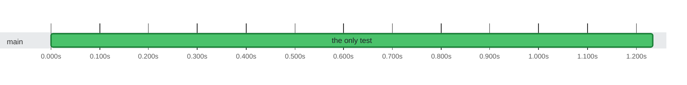

### Timeline

**1** test on **1** thread in **1.2s** · busy **100%** of the time

🟩 passed · 0:00 = 2026-10-21 08:16:56 UTC

Test timings (1)

| Start | Duration | Thread | Test | Status |
| ---: | ---: | :--- | :--- | :--- |
| 0:00.000 | 1.2s | main | the only test | ✅ passed |

