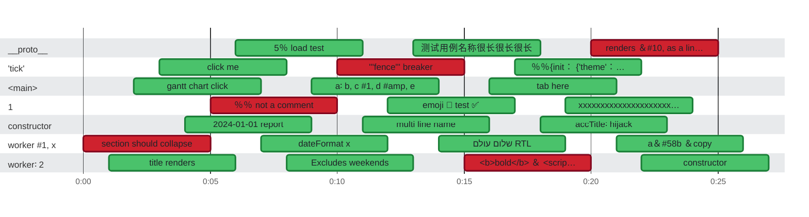

### Timeline

**23** tests on **7** threads in **27.0s** · busy **61%** of the time · up to **5** at once Slowest: `5% load test` (5.0s on `__proto__`) · Last to finish: `constructor` at 0:27.000 on `worker: 2`

🟩 passed · 🟥 failed · 0:00 = 2026-10-21 08:16:56.000 UTC

| Thread | Tests | Failed | Busy | Idle | Utilization |
| :--- | ---: | ---: | ---: | ---: | ---: |
| \_\_proto\_\_ | 3 | 1 | 15.0s | 12.0s | 56% |
| \`tick\` | 3 | 1 | 15.0s | 12.0s | 56% |
| &lt;main&gt; | 3 | 0 | 15.0s | 12.0s | 56% |
| 1 | 3 | 1 | 15.0s | 12.0s | 56% |
| constructor | 3 | 0 | 15.0s | 12.0s | 56% |
| worker #⁠1; x | 4 | 1 | 20.0s | 7.0s | 74% |
| worker: 2 | 4 | 1 | 20.0s | 7.0s | 74% |

Test timings (23)

| Start | Duration | Thread | Test | Status |
| ---: | ---: | :--- | :--- | :--- |
| 0:06.000 | 5.0s | \_\_proto\_\_ | 5% load test | ✅ passed |
| 0:13.000 | 5.0s | \_\_proto\_\_ | 测试用例名称很长很长很长 | ✅ passed |
| 0:20.000 | 5.0s | \_\_proto\_\_ | renders &amp;#⁠10; as a line break | ❌ failed |
| 0:03.000 | 5.0s | \`tick\` | click me | ✅ passed |
| 0:10.000 | 5.0s | \`tick\` | \`\`\`fence\`\`\` breaker | ❌ failed |
| 0:17.000 | 5.0s | \`tick\` | %%{init: {'theme':'forest'}}%% | ✅ passed |
| 0:02.000 | 5.0s | &lt;main&gt; | gantt chart click | ✅ passed |
| 0:09.000 | 5.0s | &lt;main&gt; | a: b; c #⁠1; d #⁠amp; e | ✅ passed |
| 0:16.000 | 5.0s | &lt;main&gt; | tab here | ✅ passed |
| 0:05.000 | 5.0s | 1 | %% not a comment | ❌ failed |
| 0:12.000 | 5.0s | 1 | emoji 🚀 test ✅ | ✅ passed |
| 0:19.000 | 5.0s | 1 | xxxxxxxxxxxxxxxxxxxxxxxxxxxxxxxxxxxxxxxxxxxxxxxxxxxxxxxxxxxxxxxxxxxxxxxxxxxxxxxx…xxxxxxxxxxxxxxxxxxxxxxxxxxxxxxxxxxxxxxx | ✅ passed |
| 0:04.000 | 5.0s | constructor | 2024-01-01 report | ✅ passed |
| 0:11.000 | 5.0s | constructor | multi line name | ✅ passed |
| 0:18.000 | 5.0s | constructor | accTitle: hijack | ✅ passed |
| 0:00.000 | 5.0s | worker #⁠1; x | section should collapse | ❌ failed |
| 0:07.000 | 5.0s | worker #⁠1; x | dateFormat x | ✅ passed |
| 0:14.000 | 5.0s | worker #⁠1; x | שלום עולם RTL | ✅ passed |
| 0:21.000 | 5.0s | worker #⁠1; x | a&amp;#⁠58b &amp;copy | ✅ passed |
| 0:01.000 | 5.0s | worker: 2 | title renders | ✅ passed |
| 0:08.000 | 5.0s | worker: 2 | Excludes weekends | ✅ passed |
| 0:15.000 | 5.0s | worker: 2 | &lt;b&gt;bold&lt;/b&gt; &amp; &lt;script&gt;x&lt;/script&gt; | ❌ failed |
| 0:22.000 | 5.0s | worker: 2 | constructor | ✅ passed |

