### Timeline

**36** tests on **3** threads in **1h 59m** · busy **94%** of the time · up to **3** at once

```mermaid
---
config:
  gantt:
    displayMode: compact
    useWidth: 1000
    leftPadding: 75
    rightPadding: 40
  themeVariables:
    taskBkgColor: '#4ac26b'
    taskBorderColor: '#1a7f37'
    critBkgColor: '#f85149'
    critBorderColor: '#cf222e'
    activeTaskBkgColor: '#eac54f'
    activeTaskBorderColor: '#9a6700'
    doneTaskBkgColor: '#afb8c1'
    doneTaskBorderColor: '#6e7781'
    taskTextColor: '#1f2328'
    taskTextDarkColor: '#1f2328'
    sectionBkgColor: '#8c959f'
    sectionBkgColor2: '#8c959f'
---
gantt
accTitle: Test execution timeline
accDescr: 36 tests on 3 threads over 1h 59m, 1 failed
dateFormat D HH:mm:ss.SSS
axisFormat %-H:%M:%S
todayMarker off
section ​w0
​long 0-0 :16 00:00:00.000, 550000ms
​long 0-1 :16 00:10:00.000, 550000ms
​long 0-2 :16 00:20:00.000, 550000ms
​long 0-3 :16 00:30:00.000, 550000ms
​long 0-4 :16 00:40:00.000, 550000ms
​long 0-5 :16 00:50:00.000, 550000ms
​long 0-6 :16 01:00:00.000, 550000ms
​long 0-7 :16 01:10:00.000, 550000ms
​long 0-8 :16 01:20:00.000, 550000ms
​long 0-9 :16 01:30:00.000, 550000ms
​long 0-10 :16 01:40:00.000, 550000ms
​long 0-11 :16 01:50:00.000, 550000ms
section ​w1
​long 1-0 :16 00:00:01.000, 560000ms
​long 1-1 :16 00:10:01.000, 560000ms
​long 1-2 :16 00:20:01.000, 560000ms
​long 1-3 :16 00:30:01.000, 560000ms
​long 1-4 :16 00:40:01.000, 560000ms
​long 1-5 :crit, 16 00:50:01.000, 560000ms
​long 1-6 :16 01:00:01.000, 560000ms
​long 1-7 :16 01:10:01.000, 560000ms
​long 1-8 :16 01:20:01.000, 560000ms
​long 1-9 :16 01:30:01.000, 560000ms
​long 1-10 :16 01:40:01.000, 560000ms
​long 1-11 :16 01:50:01.000, 560000ms
section ​w2
​long 2-0 :16 00:00:02.000, 570000ms
​long 2-1 :16 00:10:02.000, 570000ms
​long 2-2 :16 00:20:02.000, 570000ms
​long 2-3 :16 00:30:02.000, 570000ms
​long 2-4 :16 00:40:02.000, 570000ms
​long 2-5 :16 00:50:02.000, 570000ms
​long 2-6 :16 01:00:02.000, 570000ms
​long 2-7 :16 01:10:02.000, 570000ms
​long 2-8 :16 01:20:02.000, 570000ms
​long 2-9 :16 01:30:02.000, 570000ms
​long 2-10 :16 01:40:02.000, 570000ms
​long 2-11 :16 01:50:02.000, 570000ms
```

🟩 passed · 🟥 failed · 0:00 = 2026-10-21 08:16:56 UTC

| Thread | Tests | Failed | Busy | Idle | Utilization |
| :--- | ---: | ---: | ---: | ---: | ---: |
| w0 | 12 | 0 | 1h 50m | 9m 32s | 92% |
| w1 | 12 | 1 | 1h 52m | 7m 32s | 94% |
| w2 | 12 | 0 | 1h 54m | 5m 32s | 95% |

Test timings (36)

| Start | Duration | Thread | Test | Status |
| ---: | ---: | :--- | :--- | :--- |
| 0:00:00.000 | 9m 10s | w0 | long 0-0 | ✅ passed |
| 0:00:01.000 | 9m 20s | w1 | long 1-0 | ✅ passed |
| 0:00:02.000 | 9m 30s | w2 | long 2-0 | ✅ passed |
| 0:10:00.000 | 9m 10s | w0 | long 0-1 | ✅ passed |
| 0:10:01.000 | 9m 20s | w1 | long 1-1 | ✅ passed |
| 0:10:02.000 | 9m 30s | w2 | long 2-1 | ✅ passed |
| 0:20:00.000 | 9m 10s | w0 | long 0-2 | ✅ passed |
| 0:20:01.000 | 9m 20s | w1 | long 1-2 | ✅ passed |
| 0:20:02.000 | 9m 30s | w2 | long 2-2 | ✅ passed |
| 0:30:00.000 | 9m 10s | w0 | long 0-3 | ✅ passed |
| 0:30:01.000 | 9m 20s | w1 | long 1-3 | ✅ passed |
| 0:30:02.000 | 9m 30s | w2 | long 2-3 | ✅ passed |
| 0:40:00.000 | 9m 10s | w0 | long 0-4 | ✅ passed |
| 0:40:01.000 | 9m 20s | w1 | long 1-4 | ✅ passed |
| 0:40:02.000 | 9m 30s | w2 | long 2-4 | ✅ passed |
| 0:50:00.000 | 9m 10s | w0 | long 0-5 | ✅ passed |
| 0:50:01.000 | 9m 20s | w1 | long 1-5 | ❌ failed |
| 0:50:02.000 | 9m 30s | w2 | long 2-5 | ✅ passed |
| 1:00:00.000 | 9m 10s | w0 | long 0-6 | ✅ passed |
| 1:00:01.000 | 9m 20s | w1 | long 1-6 | ✅ passed |
| 1:00:02.000 | 9m 30s | w2 | long 2-6 | ✅ passed |
| 1:10:00.000 | 9m 10s | w0 | long 0-7 | ✅ passed |
| 1:10:01.000 | 9m 20s | w1 | long 1-7 | ✅ passed |
| 1:10:02.000 | 9m 30s | w2 | long 2-7 | ✅ passed |
| 1:20:00.000 | 9m 10s | w0 | long 0-8 | ✅ passed |
| 1:20:01.000 | 9m 20s | w1 | long 1-8 | ✅ passed |
| 1:20:02.000 | 9m 30s | w2 | long 2-8 | ✅ passed |
| 1:30:00.000 | 9m 10s | w0 | long 0-9 | ✅ passed |
| 1:30:01.000 | 9m 20s | w1 | long 1-9 | ✅ passed |
| 1:30:02.000 | 9m 30s | w2 | long 2-9 | ✅ passed |
| 1:40:00.000 | 9m 10s | w0 | long 0-10 | ✅ passed |
| 1:40:01.000 | 9m 20s | w1 | long 1-10 | ✅ passed |
| 1:40:02.000 | 9m 30s | w2 | long 2-10 | ✅ passed |
| 1:50:00.000 | 9m 10s | w0 | long 0-11 | ✅ passed |
| 1:50:01.000 | 9m 20s | w1 | long 1-11 | ✅ passed |
| 1:50:02.000 | 9m 30s | w2 | long 2-11 | ✅ passed |

