### Timeline

```mermaid
---
config:
  gantt:
    displayMode: compact
    useWidth: 1000
    leftPadding: 75
    rightPadding: 40
  themeCSS: ".taskText.critText0,.taskText.critText1,.taskText.critText2,.taskText.critText3{fill:#ffffff !important}.active0,.active1,.active2,.active3{stroke-dasharray:4 2}"
  themeVariables:
    taskBkgColor: '#4ac26b'
    taskBorderColor: '#1a7f37'
    critBkgColor: '#cf222e'
    critBorderColor: '#82071e'
    activeTaskBkgColor: '#eac54f'
    activeTaskBorderColor: '#9a6700'
    doneTaskBkgColor: '#afb8c1'
    doneTaskBorderColor: '#6e7781'
    taskTextColor: '#1f2328'
    taskTextDarkColor: '#1f2328'
    sectionBkgColor: '#8c959f'
    sectionBkgColor2: '#8c959f'
    vertLineColor: '#8c959f'
---
gantt
accTitle: Test execution timeline
accDescr: 20 tests on 2 threads over 400ms, 1 failed. The slowest test is fast 0-0 (35ms on w0). The last to finish is fast 1-9 on w1, at 0:00.400.
dateFormat D HH:mm:ss.SSS
axisFormat %-S.%Ls
todayMarker off
section ​w0
​ :16 00:00:00.000, 0ms
​fast 0-0 :16 00:00:00.000, 35ms
​fast 0-1 :16 00:00:00.040, 35ms
​fast 0-2 :16 00:00:00.080, 35ms
​fast 0-3 :16 00:00:00.120, 35ms
​fast 0-4 :crit, 16 00:00:00.160, 35ms
​fast 0-5 :16 00:00:00.200, 35ms
​fast 0-6 :16 00:00:00.240, 35ms
​fast 0-7 :16 00:00:00.280, 35ms
​fast 0-8 :16 00:00:00.320, 35ms
​fast 0-9 :16 00:00:00.360, 35ms
​ :16 00:00:00.400, 0ms
section ​w1
​fast 1-0 :16 00:00:00.005, 35ms
​fast 1-1 :16 00:00:00.045, 35ms
​fast 1-2 :16 00:00:00.085, 35ms
​fast 1-3 :16 00:00:00.125, 35ms
​fast 1-4 :16 00:00:00.165, 35ms
​fast 1-5 :16 00:00:00.205, 35ms
​fast 1-6 :16 00:00:00.245, 35ms
​fast 1-7 :16 00:00:00.285, 35ms
​fast 1-8 :16 00:00:00.325, 35ms
​fast 1-9 :16 00:00:00.365, 35ms
```

**20** tests on **2** threads in **400ms** · busy **88%** of the time · up to **2** at once Slowest: `fast 0-0` (35ms on `w0`) · Last to finish: `fast 1-9` at 0:00.400 on `w1`

🟩 passed · 🟥 failed · 0:00 = 2026-10-21 08:16:56.000 UTC

| Thread | Tests | Failed | Busy | Idle | Utilization |
| :--- | ---: | ---: | ---: | ---: | ---: |
| w0 | 10 | 1 | 350ms | 50ms | 88% |
| w1 | 10 | 0 | 350ms | 50ms | 88% |

Test timings (20)

| Start | Duration | Thread | Test | Status |
| ---: | ---: | :--- | :--- | :--- |
| 0:00.000 | 35ms | w0 | fast 0-0 | ✅ passed |
| 0:00.040 | 35ms | w0 | fast 0-1 | ✅ passed |
| 0:00.080 | 35ms | w0 | fast 0-2 | ✅ passed |
| 0:00.120 | 35ms | w0 | fast 0-3 | ✅ passed |
| 0:00.160 | 35ms | w0 | fast 0-4 | ❌ failed |
| 0:00.200 | 35ms | w0 | fast 0-5 | ✅ passed |
| 0:00.240 | 35ms | w0 | fast 0-6 | ✅ passed |
| 0:00.280 | 35ms | w0 | fast 0-7 | ✅ passed |
| 0:00.320 | 35ms | w0 | fast 0-8 | ✅ passed |
| 0:00.360 | 35ms | w0 | fast 0-9 | ✅ passed |
| 0:00.005 | 35ms | w1 | fast 1-0 | ✅ passed |
| 0:00.045 | 35ms | w1 | fast 1-1 | ✅ passed |
| 0:00.085 | 35ms | w1 | fast 1-2 | ✅ passed |
| 0:00.125 | 35ms | w1 | fast 1-3 | ✅ passed |
| 0:00.165 | 35ms | w1 | fast 1-4 | ✅ passed |
| 0:00.205 | 35ms | w1 | fast 1-5 | ✅ passed |
| 0:00.245 | 35ms | w1 | fast 1-6 | ✅ passed |
| 0:00.285 | 35ms | w1 | fast 1-7 | ✅ passed |
| 0:00.325 | 35ms | w1 | fast 1-8 | ✅ passed |
| 0:00.365 | 35ms | w1 | fast 1-9 | ✅ passed |

