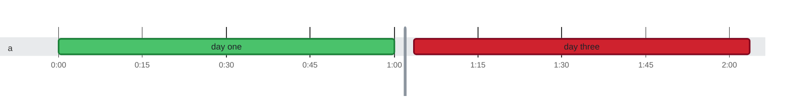

### Timeline

**2** tests on **1** thread in **2m** · busy **100%** of the time Slowest: `day one` (1m on `a`) · Last to finish: `day three` at 50:01:00.000 on `a`

🟩 passed · 🟥 failed · 0:00 = 2026-10-21 08:16:56.000 UTC
 No test ran for 49h 59m, so that stretch is cut out of the chart at the gray line; the tables show real times.

Test timings (2)

| Start | Duration | Thread | Test | Status |
| ---: | ---: | :--- | :--- | :--- |
| 0:00:00.000 | 1m | a | day one | ✅ passed |
| 50:00:00.000 | 1m | a | day three | ❌ failed |

