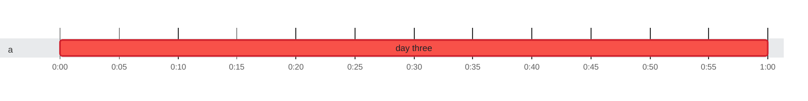

### Timeline

**1** test on **1** thread in **1m** · busy **100%** of the time

🟥 failed · 0:00 = 2026-10-23 10:16:56 UTC
 1 test from another run in the same report is not shown: they ran 49h 59m or more before or after these.

Test timings (1)

| Start | Duration | Thread | Test | Status |
| ---: | ---: | :--- | :--- | :--- |
| 0:00.000 | 1m | a | day three | ❌ failed |

