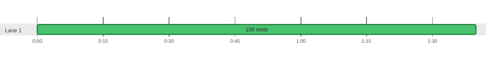

### Timeline

**100** tests on **1** lane in **1m 39s** · busy **90%** of the time

🟩 passed · 0:00 = 2026-10-21 08:16:56 UTC
 The report has 100 thread IDs, too many for one lane each, so lanes are inferred from start and stop times.
 Tests too short to tell apart are merged into one bar.

Test timings (100)

| Start | Duration | Lane | Test | Status |
| ---: | ---: | :--- | :--- | :--- |
| 0:00.000 | 900ms | Lane 1 | seq 0 | ✅ passed |
| 0:01.000 | 900ms | Lane 1 | seq 1 | ✅ passed |
| 0:02.000 | 900ms | Lane 1 | seq 2 | ✅ passed |
| 0:03.000 | 900ms | Lane 1 | seq 3 | ✅ passed |
| 0:04.000 | 900ms | Lane 1 | seq 4 | ✅ passed |
| 0:05.000 | 900ms | Lane 1 | seq 5 | ✅ passed |
| 0:06.000 | 900ms | Lane 1 | seq 6 | ✅ passed |
| 0:07.000 | 900ms | Lane 1 | seq 7 | ✅ passed |
| 0:08.000 | 900ms | Lane 1 | seq 8 | ✅ passed |
| 0:09.000 | 900ms | Lane 1 | seq 9 | ✅ passed |
| 0:10.000 | 900ms | Lane 1 | seq 10 | ✅ passed |
| 0:11.000 | 900ms | Lane 1 | seq 11 | ✅ passed |
| 0:12.000 | 900ms | Lane 1 | seq 12 | ✅ passed |
| 0:13.000 | 900ms | Lane 1 | seq 13 | ✅ passed |
| 0:14.000 | 900ms | Lane 1 | seq 14 | ✅ passed |
| 0:15.000 | 900ms | Lane 1 | seq 15 | ✅ passed |
| 0:16.000 | 900ms | Lane 1 | seq 16 | ✅ passed |
| 0:17.000 | 900ms | Lane 1 | seq 17 | ✅ passed |
| 0:18.000 | 900ms | Lane 1 | seq 18 | ✅ passed |
| 0:19.000 | 900ms | Lane 1 | seq 19 | ✅ passed |
| 0:20.000 | 900ms | Lane 1 | seq 20 | ✅ passed |
| 0:21.000 | 900ms | Lane 1 | seq 21 | ✅ passed |
| 0:22.000 | 900ms | Lane 1 | seq 22 | ✅ passed |
| 0:23.000 | 900ms | Lane 1 | seq 23 | ✅ passed |
| 0:24.000 | 900ms | Lane 1 | seq 24 | ✅ passed |
| 0:25.000 | 900ms | Lane 1 | seq 25 | ✅ passed |
| 0:26.000 | 900ms | Lane 1 | seq 26 | ✅ passed |
| 0:27.000 | 900ms | Lane 1 | seq 27 | ✅ passed |
| 0:28.000 | 900ms | Lane 1 | seq 28 | ✅ passed |
| 0:29.000 | 900ms | Lane 1 | seq 29 | ✅ passed |
| 0:30.000 | 900ms | Lane 1 | seq 30 | ✅ passed |
| 0:31.000 | 900ms | Lane 1 | seq 31 | ✅ passed |
| 0:32.000 | 900ms | Lane 1 | seq 32 | ✅ passed |
| 0:33.000 | 900ms | Lane 1 | seq 33 | ✅ passed |
| 0:34.000 | 900ms | Lane 1 | seq 34 | ✅ passed |
| 0:35.000 | 900ms | Lane 1 | seq 35 | ✅ passed |
| 0:36.000 | 900ms | Lane 1 | seq 36 | ✅ passed |
| 0:37.000 | 900ms | Lane 1 | seq 37 | ✅ passed |
| 0:38.000 | 900ms | Lane 1 | seq 38 | ✅ passed |
| 0:39.000 | 900ms | Lane 1 | seq 39 | ✅ passed |
| 0:40.000 | 900ms | Lane 1 | seq 40 | ✅ passed |
| 0:41.000 | 900ms | Lane 1 | seq 41 | ✅ passed |
| 0:42.000 | 900ms | Lane 1 | seq 42 | ✅ passed |
| 0:43.000 | 900ms | Lane 1 | seq 43 | ✅ passed |
| 0:44.000 | 900ms | Lane 1 | seq 44 | ✅ passed |
| 0:45.000 | 900ms | Lane 1 | seq 45 | ✅ passed |
| 0:46.000 | 900ms | Lane 1 | seq 46 | ✅ passed |
| 0:47.000 | 900ms | Lane 1 | seq 47 | ✅ passed |
| 0:48.000 | 900ms | Lane 1 | seq 48 | ✅ passed |
| 0:49.000 | 900ms | Lane 1 | seq 49 | ✅ passed |
| 0:50.000 | 900ms | Lane 1 | seq 50 | ✅ passed |
| 0:51.000 | 900ms | Lane 1 | seq 51 | ✅ passed |
| 0:52.000 | 900ms | Lane 1 | seq 52 | ✅ passed |
| 0:53.000 | 900ms | Lane 1 | seq 53 | ✅ passed |
| 0:54.000 | 900ms | Lane 1 | seq 54 | ✅ passed |
| 0:55.000 | 900ms | Lane 1 | seq 55 | ✅ passed |
| 0:56.000 | 900ms | Lane 1 | seq 56 | ✅ passed |
| 0:57.000 | 900ms | Lane 1 | seq 57 | ✅ passed |
| 0:58.000 | 900ms | Lane 1 | seq 58 | ✅ passed |
| 0:59.000 | 900ms | Lane 1 | seq 59 | ✅ passed |
| 1:00.000 | 900ms | Lane 1 | seq 60 | ✅ passed |
| 1:01.000 | 900ms | Lane 1 | seq 61 | ✅ passed |
| 1:02.000 | 900ms | Lane 1 | seq 62 | ✅ passed |
| 1:03.000 | 900ms | Lane 1 | seq 63 | ✅ passed |
| 1:04.000 | 900ms | Lane 1 | seq 64 | ✅ passed |
| 1:05.000 | 900ms | Lane 1 | seq 65 | ✅ passed |
| 1:06.000 | 900ms | Lane 1 | seq 66 | ✅ passed |
| 1:07.000 | 900ms | Lane 1 | seq 67 | ✅ passed |
| 1:08.000 | 900ms | Lane 1 | seq 68 | ✅ passed |
| 1:09.000 | 900ms | Lane 1 | seq 69 | ✅ passed |
| 1:10.000 | 900ms | Lane 1 | seq 70 | ✅ passed |
| 1:11.000 | 900ms | Lane 1 | seq 71 | ✅ passed |
| 1:12.000 | 900ms | Lane 1 | seq 72 | ✅ passed |
| 1:13.000 | 900ms | Lane 1 | seq 73 | ✅ passed |
| 1:14.000 | 900ms | Lane 1 | seq 74 | ✅ passed |
| 1:15.000 | 900ms | Lane 1 | seq 75 | ✅ passed |
| 1:16.000 | 900ms | Lane 1 | seq 76 | ✅ passed |
| 1:17.000 | 900ms | Lane 1 | seq 77 | ✅ passed |
| 1:18.000 | 900ms | Lane 1 | seq 78 | ✅ passed |
| 1:19.000 | 900ms | Lane 1 | seq 79 | ✅ passed |
| 1:20.000 | 900ms | Lane 1 | seq 80 | ✅ passed |
| 1:21.000 | 900ms | Lane 1 | seq 81 | ✅ passed |
| 1:22.000 | 900ms | Lane 1 | seq 82 | ✅ passed |
| 1:23.000 | 900ms | Lane 1 | seq 83 | ✅ passed |
| 1:24.000 | 900ms | Lane 1 | seq 84 | ✅ passed |
| 1:25.000 | 900ms | Lane 1 | seq 85 | ✅ passed |
| 1:26.000 | 900ms | Lane 1 | seq 86 | ✅ passed |
| 1:27.000 | 900ms | Lane 1 | seq 87 | ✅ passed |
| 1:28.000 | 900ms | Lane 1 | seq 88 | ✅ passed |
| 1:29.000 | 900ms | Lane 1 | seq 89 | ✅ passed |
| 1:30.000 | 900ms | Lane 1 | seq 90 | ✅ passed |
| 1:31.000 | 900ms | Lane 1 | seq 91 | ✅ passed |
| 1:32.000 | 900ms | Lane 1 | seq 92 | ✅ passed |
| 1:33.000 | 900ms | Lane 1 | seq 93 | ✅ passed |
| 1:34.000 | 900ms | Lane 1 | seq 94 | ✅ passed |
| 1:35.000 | 900ms | Lane 1 | seq 95 | ✅ passed |
| 1:36.000 | 900ms | Lane 1 | seq 96 | ✅ passed |
| 1:37.000 | 900ms | Lane 1 | seq 97 | ✅ passed |
| 1:38.000 | 900ms | Lane 1 | seq 98 | ✅ passed |
| 1:39.000 | 900ms | Lane 1 | seq 99 | ✅ passed |

