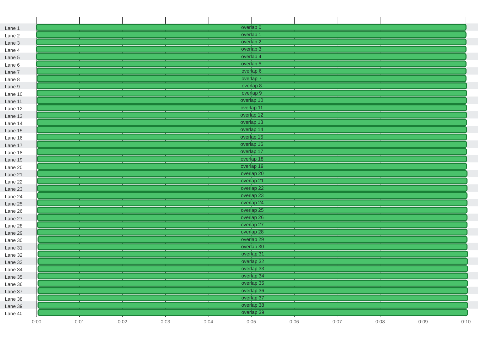

### Timeline

**60** tests on **60** lanes in **10.1s** · busy **99%** of the time · up to **60** at once

🟩 passed · 0:00 = 2026-10-21 08:16:56 UTC
 The report has no thread IDs (<code>threadId</code>), so lanes are inferred from start and stop times.
 So many tests overlap that the times may have been recorded after the tests ran; if fewer workers ran, the lanes do not match them.
 20 more lanes with 20 tests are not drawn; their failures are still listed in the test timings.

| Lane | Tests | Failed | Busy | Idle | Utilization |
| :--- | ---: | ---: | ---: | ---: | ---: |
| Lane 1 | 1 | 0 | 10.0s | 59ms | 99% |
| Lane 2 | 1 | 0 | 10.0s | 59ms | 99% |
| Lane 3 | 1 | 0 | 10.0s | 59ms | 99% |
| Lane 4 | 1 | 0 | 10.0s | 59ms | 99% |
| Lane 5 | 1 | 0 | 10.0s | 59ms | 99% |
| Lane 6 | 1 | 0 | 10.0s | 59ms | 99% |
| Lane 7 | 1 | 0 | 10.0s | 59ms | 99% |
| Lane 8 | 1 | 0 | 10.0s | 59ms | 99% |
| Lane 9 | 1 | 0 | 10.0s | 59ms | 99% |
| Lane 10 | 1 | 0 | 10.0s | 59ms | 99% |
| Lane 11 | 1 | 0 | 10.0s | 59ms | 99% |
| Lane 12 | 1 | 0 | 10.0s | 59ms | 99% |
| Lane 13 | 1 | 0 | 10.0s | 59ms | 99% |
| Lane 14 | 1 | 0 | 10.0s | 59ms | 99% |
| Lane 15 | 1 | 0 | 10.0s | 59ms | 99% |
| Lane 16 | 1 | 0 | 10.0s | 59ms | 99% |
| Lane 17 | 1 | 0 | 10.0s | 59ms | 99% |
| Lane 18 | 1 | 0 | 10.0s | 59ms | 99% |
| Lane 19 | 1 | 0 | 10.0s | 59ms | 99% |
| Lane 20 | 1 | 0 | 10.0s | 59ms | 99% |
| Lane 21 | 1 | 0 | 10.0s | 59ms | 99% |
| Lane 22 | 1 | 0 | 10.0s | 59ms | 99% |
| Lane 23 | 1 | 0 | 10.0s | 59ms | 99% |
| Lane 24 | 1 | 0 | 10.0s | 59ms | 99% |
| Lane 25 | 1 | 0 | 10.0s | 59ms | 99% |
| Lane 26 | 1 | 0 | 10.0s | 59ms | 99% |
| Lane 27 | 1 | 0 | 10.0s | 59ms | 99% |
| Lane 28 | 1 | 0 | 10.0s | 59ms | 99% |
| Lane 29 | 1 | 0 | 10.0s | 59ms | 99% |
| Lane 30 | 1 | 0 | 10.0s | 59ms | 99% |
| Lane 31 | 1 | 0 | 10.0s | 59ms | 99% |
| Lane 32 | 1 | 0 | 10.0s | 59ms | 99% |
| Lane 33 | 1 | 0 | 10.0s | 59ms | 99% |
| Lane 34 | 1 | 0 | 10.0s | 59ms | 99% |
| Lane 35 | 1 | 0 | 10.0s | 59ms | 99% |
| Lane 36 | 1 | 0 | 10.0s | 59ms | 99% |
| Lane 37 | 1 | 0 | 10.0s | 59ms | 99% |
| Lane 38 | 1 | 0 | 10.0s | 59ms | 99% |
| Lane 39 | 1 | 0 | 10.0s | 59ms | 99% |
| Lane 40 | 1 | 0 | 10.0s | 59ms | 99% |

Test timings (60)

| Start | Duration | Lane | Test | Status |
| ---: | ---: | :--- | :--- | :--- |
| 0:00.000 | 10.0s | Lane 1 | overlap 0 | ✅ passed |
| 0:00.001 | 10.0s | Lane 2 | overlap 1 | ✅ passed |
| 0:00.002 | 10.0s | Lane 3 | overlap 2 | ✅ passed |
| 0:00.003 | 10.0s | Lane 4 | overlap 3 | ✅ passed |
| 0:00.004 | 10.0s | Lane 5 | overlap 4 | ✅ passed |
| 0:00.005 | 10.0s | Lane 6 | overlap 5 | ✅ passed |
| 0:00.006 | 10.0s | Lane 7 | overlap 6 | ✅ passed |
| 0:00.007 | 10.0s | Lane 8 | overlap 7 | ✅ passed |
| 0:00.008 | 10.0s | Lane 9 | overlap 8 | ✅ passed |
| 0:00.009 | 10.0s | Lane 10 | overlap 9 | ✅ passed |
| 0:00.010 | 10.0s | Lane 11 | overlap 10 | ✅ passed |
| 0:00.011 | 10.0s | Lane 12 | overlap 11 | ✅ passed |
| 0:00.012 | 10.0s | Lane 13 | overlap 12 | ✅ passed |
| 0:00.013 | 10.0s | Lane 14 | overlap 13 | ✅ passed |
| 0:00.014 | 10.0s | Lane 15 | overlap 14 | ✅ passed |
| 0:00.015 | 10.0s | Lane 16 | overlap 15 | ✅ passed |
| 0:00.016 | 10.0s | Lane 17 | overlap 16 | ✅ passed |
| 0:00.017 | 10.0s | Lane 18 | overlap 17 | ✅ passed |
| 0:00.018 | 10.0s | Lane 19 | overlap 18 | ✅ passed |
| 0:00.019 | 10.0s | Lane 20 | overlap 19 | ✅ passed |
| 0:00.020 | 10.0s | Lane 21 | overlap 20 | ✅ passed |
| 0:00.021 | 10.0s | Lane 22 | overlap 21 | ✅ passed |
| 0:00.022 | 10.0s | Lane 23 | overlap 22 | ✅ passed |
| 0:00.023 | 10.0s | Lane 24 | overlap 23 | ✅ passed |
| 0:00.024 | 10.0s | Lane 25 | overlap 24 | ✅ passed |
| 0:00.025 | 10.0s | Lane 26 | overlap 25 | ✅ passed |
| 0:00.026 | 10.0s | Lane 27 | overlap 26 | ✅ passed |
| 0:00.027 | 10.0s | Lane 28 | overlap 27 | ✅ passed |
| 0:00.028 | 10.0s | Lane 29 | overlap 28 | ✅ passed |
| 0:00.029 | 10.0s | Lane 30 | overlap 29 | ✅ passed |
| 0:00.030 | 10.0s | Lane 31 | overlap 30 | ✅ passed |
| 0:00.031 | 10.0s | Lane 32 | overlap 31 | ✅ passed |
| 0:00.032 | 10.0s | Lane 33 | overlap 32 | ✅ passed |
| 0:00.033 | 10.0s | Lane 34 | overlap 33 | ✅ passed |
| 0:00.034 | 10.0s | Lane 35 | overlap 34 | ✅ passed |
| 0:00.035 | 10.0s | Lane 36 | overlap 35 | ✅ passed |
| 0:00.036 | 10.0s | Lane 37 | overlap 36 | ✅ passed |
| 0:00.037 | 10.0s | Lane 38 | overlap 37 | ✅ passed |
| 0:00.038 | 10.0s | Lane 39 | overlap 38 | ✅ passed |
| 0:00.039 | 10.0s | Lane 40 | overlap 39 | ✅ passed |
| 0:00.040 | 10.0s | Lane 41 | overlap 40 | ✅ passed |
| 0:00.041 | 10.0s | Lane 42 | overlap 41 | ✅ passed |
| 0:00.042 | 10.0s | Lane 43 | overlap 42 | ✅ passed |
| 0:00.043 | 10.0s | Lane 44 | overlap 43 | ✅ passed |
| 0:00.044 | 10.0s | Lane 45 | overlap 44 | ✅ passed |
| 0:00.045 | 10.0s | Lane 46 | overlap 45 | ✅ passed |
| 0:00.046 | 10.0s | Lane 47 | overlap 46 | ✅ passed |
| 0:00.047 | 10.0s | Lane 48 | overlap 47 | ✅ passed |
| 0:00.048 | 10.0s | Lane 49 | overlap 48 | ✅ passed |
| 0:00.049 | 10.0s | Lane 50 | overlap 49 | ✅ passed |
| 0:00.050 | 10.0s | Lane 51 | overlap 50 | ✅ passed |
| 0:00.051 | 10.0s | Lane 52 | overlap 51 | ✅ passed |
| 0:00.052 | 10.0s | Lane 53 | overlap 52 | ✅ passed |
| 0:00.053 | 10.0s | Lane 54 | overlap 53 | ✅ passed |
| 0:00.054 | 10.0s | Lane 55 | overlap 54 | ✅ passed |
| 0:00.055 | 10.0s | Lane 56 | overlap 55 | ✅ passed |
| 0:00.056 | 10.0s | Lane 57 | overlap 56 | ✅ passed |
| 0:00.057 | 10.0s | Lane 58 | overlap 57 | ✅ passed |
| 0:00.058 | 10.0s | Lane 59 | overlap 58 | ✅ passed |
| 0:00.059 | 10.0s | Lane 60 | overlap 59 | ✅ passed |

