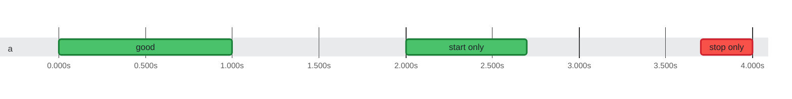

### Timeline

**3** tests on **1** thread in **4.0s** · busy **50%** of the time

🟩 passed · 🟥 failed · 0:00 = 2026-10-21 08:16:56 UTC
 1 test without start and stop times is not shown.
 1 test with a stop time before the start time is not shown.
 1 skipped or pending test is not shown.

Test timings (3)

| Start | Duration | Thread | Test | Status |
| ---: | ---: | :--- | :--- | :--- |
| 0:00.000 | 1.0s | a | good | ✅ passed |
| 0:02.000 | 700ms | a | start only | ✅ passed |
| 0:03.700 | 300ms | a | stop only | ❌ failed |

