### Timeline

```mermaid
---
config:
  gantt:
    displayMode: compact
    useWidth: 1000
    leftPadding: 75
    rightPadding: 40
  themeCSS: ".taskText.critText0,.taskText.critText1,.taskText.critText2,.taskText.critText3{fill:#ffffff !important}.active0,.active1,.active2,.active3{stroke-dasharray:4 2}"
  themeVariables:
    taskBkgColor: '#4ac26b'
    taskBorderColor: '#1a7f37'
    critBkgColor: '#cf222e'
    critBorderColor: '#82071e'
    activeTaskBkgColor: '#eac54f'
    activeTaskBorderColor: '#9a6700'
    doneTaskBkgColor: '#afb8c1'
    doneTaskBorderColor: '#6e7781'
    taskTextColor: '#1f2328'
    taskTextDarkColor: '#1f2328'
    sectionBkgColor: '#8c959f'
    sectionBkgColor2: '#8c959f'
    vertLineColor: '#8c959f'
---
gantt
accTitle: Test execution timeline
accDescr: 60 tests and 20 earlier attempts on 3 threads over 1m 10s, 0 failed. The slowest test is shard 1 test 19 (2.1s on shard-1). The last to finish is shard 3 test 19 on shard-3, at 2:00:35.410.
dateFormat D HH:mm:ss.SSS
axisFormat %-M:%S
todayMarker off
section ​shard-1
​ :16 00:00:00.000, 0ms
​ :16 00:00:00.000, 1400ms
​ :16 00:00:01.420, 1437ms
​ :16 00:00:02.877, 1474ms
​ :16 00:00:04.371, 1511ms
​ :16 00:00:05.902, 1548ms
​ :16 00:00:07.470, 1585ms
​ :16 00:00:09.075, 1622ms
​ :16 00:00:10.717, 1659ms
​ :16 00:00:12.396, 1696ms
​ :16 00:00:14.112, 1733ms
​ :16 00:00:15.865, 1770ms
​ :16 00:00:17.655, 1807ms
​ :16 00:00:19.482, 1844ms
​ :16 00:00:21.346, 1881ms
​ :16 00:00:23.247, 1918ms
​ :16 00:00:25.185, 1955ms
​ :16 00:00:27.160, 1992ms
​ :16 00:00:29.172, 2029ms
​ :16 00:00:31.221, 2066ms
​ :16 00:00:33.307, 2103ms
​ :16 00:01:12.945, 0ms
​ :vert, 16 00:00:36.473, 0ms
section ​shard-2
​ :16 00:00:00.000, 1400ms
​ :16 00:00:01.420, 1437ms
​ :16 00:00:02.877, 1474ms
​ :16 00:00:04.371, 1511ms
​ :16 00:00:05.902, 1548ms
​ :16 00:00:07.470, 1585ms
​ :16 00:00:09.075, 1622ms
​ :16 00:00:10.717, 1659ms
​ :16 00:00:12.396, 1696ms
​ :16 00:00:14.112, 1733ms
​ :16 00:00:15.865, 1770ms
​ :16 00:00:17.655, 1807ms
​ :16 00:00:19.482, 1844ms
​ :16 00:00:21.346, 1881ms
​ :16 00:00:23.247, 1918ms
​ :16 00:00:25.185, 1955ms
​ :16 00:00:27.160, 1992ms
​ :16 00:00:29.172, 2029ms
​ :16 00:00:31.221, 2066ms
​ :16 00:00:33.307, 2103ms
section ​shard-3
​ :16 00:00:00.000, 1400ms
​ :16 00:00:01.420, 1437ms
​ :16 00:00:02.877, 1474ms
​ :16 00:00:04.371, 1511ms
​ :16 00:00:05.902, 1548ms
​ :16 00:00:07.470, 1585ms
​ :16 00:00:09.075, 1622ms
​ :active, 16 00:00:10.717, 1659ms
​ :16 00:00:12.396, 1696ms
​ :16 00:00:14.112, 1733ms
​ :16 00:00:15.865, 1770ms
​ :16 00:00:17.655, 1807ms
​ :16 00:00:19.482, 1844ms
​ :16 00:00:21.346, 1881ms
​ :16 00:00:23.247, 1918ms
​ :16 00:00:25.185, 1955ms
​ :16 00:00:27.160, 1992ms
​ :16 00:00:29.172, 2029ms
​ :16 00:00:31.221, 2066ms
​ :16 00:00:33.307, 2103ms
​ :16 00:00:37.535, 1400ms
​ :16 00:00:38.955, 1437ms
​ :16 00:00:40.412, 1474ms
​ :16 00:00:41.906, 1511ms
​ :16 00:00:43.437, 1548ms
​ :16 00:00:45.005, 1585ms
​ :16 00:00:46.610, 1622ms
​ :16 00:00:48.252, 1659ms
​ :16 00:00:49.931, 1696ms
​ :16 00:00:51.647, 1733ms
​ :16 00:00:53.400, 1770ms
​ :16 00:00:55.190, 1807ms
​ :16 00:00:57.017, 1844ms
​ :16 00:00:58.881, 1881ms
​ :16 00:01:00.782, 1918ms
​ :16 00:01:02.720, 1955ms
​ :16 00:01:04.695, 1992ms
​ :16 00:01:06.707, 2029ms
​ :16 00:01:08.756, 2066ms
​ :16 00:01:10.842, 2103ms
```

**60** tests and **20** earlier attempts on **3** threads in **1m 10s** · busy **66%** of the time · up to **3** at once Slowest: `shard 1 test 19` (2.1s on `shard-1`) · Last to finish: `shard 3 test 19` at 2:00:35.410 on `shard-3`

🟩 passed · 🟨 failed, then retried (dashed) · 0:00 = 2026-10-21 08:16:56.000 UTC
 20 earlier results of tests that ran again later in the report are drawn as earlier attempts.
 No test ran for 1h 59m, so that stretch is cut out of the chart at the gray line; the tables show real times.

| Thread | Tests | Earlier attempts | Failed | Busy | Idle | Utilization |
| :--- | ---: | ---: | ---: | ---: | ---: | ---: |
| shard-1 | 20 | 0 | 0 | 35.0s | 35.8s | 49% |
| shard-2 | 20 | 0 | 0 | 35.0s | 35.8s | 49% |
| shard-3 | 20 | 20 | 0 | 1m 10s | 760ms | 99% |

Test timings (80)

| Start | Duration | Thread | Test | Status |
| ---: | ---: | :--- | :--- | :--- |
| 0:00:00.000 | 1.4s | shard-1 | shard 1 test 0 | ✅ passed |
| 0:00:01.420 | 1.4s | shard-1 | shard 1 test 1 | ✅ passed |
| 0:00:02.877 | 1.5s | shard-1 | shard 1 test 2 | ✅ passed |
| 0:00:04.371 | 1.5s | shard-1 | shard 1 test 3 | ✅ passed |
| 0:00:05.902 | 1.5s | shard-1 | shard 1 test 4 | ✅ passed |
| 0:00:07.470 | 1.6s | shard-1 | shard 1 test 5 | ✅ passed |
| 0:00:09.075 | 1.6s | shard-1 | shard 1 test 6 | ✅ passed |
| 0:00:10.717 | 1.7s | shard-1 | shard 1 test 7 | ✅ passed |
| 0:00:12.396 | 1.7s | shard-1 | shard 1 test 8 | ✅ passed |
| 0:00:14.112 | 1.7s | shard-1 | shard 1 test 9 | ✅ passed |
| 0:00:15.865 | 1.8s | shard-1 | shard 1 test 10 | ✅ passed |
| 0:00:17.655 | 1.8s | shard-1 | shard 1 test 11 | ✅ passed |
| 0:00:19.482 | 1.8s | shard-1 | shard 1 test 12 | ✅ passed |
| 0:00:21.346 | 1.9s | shard-1 | shard 1 test 13 | ✅ passed |
| 0:00:23.247 | 1.9s | shard-1 | shard 1 test 14 | ✅ passed |
| 0:00:25.185 | 2.0s | shard-1 | shard 1 test 15 | ✅ passed |
| 0:00:27.160 | 2.0s | shard-1 | shard 1 test 16 | ✅ passed |
| 0:00:29.172 | 2.0s | shard-1 | shard 1 test 17 | ✅ passed |
| 0:00:31.221 | 2.1s | shard-1 | shard 1 test 18 | ✅ passed |
| 0:00:33.307 | 2.1s | shard-1 | shard 1 test 19 | ✅ passed |
| 0:00:00.000 | 1.4s | shard-2 | shard 2 test 0 | ✅ passed |
| 0:00:01.420 | 1.4s | shard-2 | shard 2 test 1 | ✅ passed |
| 0:00:02.877 | 1.5s | shard-2 | shard 2 test 2 | ✅ passed |
| 0:00:04.371 | 1.5s | shard-2 | shard 2 test 3 | ✅ passed |
| 0:00:05.902 | 1.5s | shard-2 | shard 2 test 4 | ✅ passed |
| 0:00:07.470 | 1.6s | shard-2 | shard 2 test 5 | ✅ passed |
| 0:00:09.075 | 1.6s | shard-2 | shard 2 test 6 | ✅ passed |
| 0:00:10.717 | 1.7s | shard-2 | shard 2 test 7 | ✅ passed |
| 0:00:12.396 | 1.7s | shard-2 | shard 2 test 8 | ✅ passed |
| 0:00:14.112 | 1.7s | shard-2 | shard 2 test 9 | ✅ passed |
| 0:00:15.865 | 1.8s | shard-2 | shard 2 test 10 | ✅ passed |
| 0:00:17.655 | 1.8s | shard-2 | shard 2 test 11 | ✅ passed |
| 0:00:19.482 | 1.8s | shard-2 | shard 2 test 12 | ✅ passed |
| 0:00:21.346 | 1.9s | shard-2 | shard 2 test 13 | ✅ passed |
| 0:00:23.247 | 1.9s | shard-2 | shard 2 test 14 | ✅ passed |
| 0:00:25.185 | 2.0s | shard-2 | shard 2 test 15 | ✅ passed |
| 0:00:27.160 | 2.0s | shard-2 | shard 2 test 16 | ✅ passed |
| 0:00:29.172 | 2.0s | shard-2 | shard 2 test 17 | ✅ passed |
| 0:00:31.221 | 2.1s | shard-2 | shard 2 test 18 | ✅ passed |
| 0:00:33.307 | 2.1s | shard-2 | shard 2 test 19 | ✅ passed |
| 0:00:00.000 | 1.4s | shard-3 | shard 3 test 0 (earlier run) | ✅ passed |
| 0:00:01.420 | 1.4s | shard-3 | shard 3 test 1 (earlier run) | ✅ passed |
| 0:00:02.877 | 1.5s | shard-3 | shard 3 test 2 (earlier run) | ✅ passed |
| 0:00:04.371 | 1.5s | shard-3 | shard 3 test 3 (earlier run) | ✅ passed |
| 0:00:05.902 | 1.5s | shard-3 | shard 3 test 4 (earlier run) | ✅ passed |
| 0:00:07.470 | 1.6s | shard-3 | shard 3 test 5 (earlier run) | ✅ passed |
| 0:00:09.075 | 1.6s | shard-3 | shard 3 test 6 (earlier run) | ✅ passed |
| 0:00:10.717 | 1.7s | shard-3 | checkout fails (earlier run) | ❌ failed |
| 0:00:12.396 | 1.7s | shard-3 | shard 3 test 8 (earlier run) | ✅ passed |
| 0:00:14.112 | 1.7s | shard-3 | shard 3 test 9 (earlier run) | ✅ passed |
| 0:00:15.865 | 1.8s | shard-3 | shard 3 test 10 (earlier run) | ✅ passed |
| 0:00:17.655 | 1.8s | shard-3 | shard 3 test 11 (earlier run) | ✅ passed |
| 0:00:19.482 | 1.8s | shard-3 | shard 3 test 12 (earlier run) | ✅ passed |
| 0:00:21.346 | 1.9s | shard-3 | shard 3 test 13 (earlier run) | ✅ passed |
| 0:00:23.247 | 1.9s | shard-3 | shard 3 test 14 (earlier run) | ✅ passed |
| 0:00:25.185 | 2.0s | shard-3 | shard 3 test 15 (earlier run) | ✅ passed |
| 0:00:27.160 | 2.0s | shard-3 | shard 3 test 16 (earlier run) | ✅ passed |
| 0:00:29.172 | 2.0s | shard-3 | shard 3 test 17 (earlier run) | ✅ passed |
| 0:00:31.221 | 2.1s | shard-3 | shard 3 test 18 (earlier run) | ✅ passed |
| 0:00:33.307 | 2.1s | shard-3 | shard 3 test 19 (earlier run) | ✅ passed |
| 2:00:00.000 | 1.4s | shard-3 | shard 3 test 0 | ✅ passed |
| 2:00:01.420 | 1.4s | shard-3 | shard 3 test 1 | ✅ passed |
| 2:00:02.877 | 1.5s | shard-3 | shard 3 test 2 | ✅ passed |
| 2:00:04.371 | 1.5s | shard-3 | shard 3 test 3 | ✅ passed |
| 2:00:05.902 | 1.5s | shard-3 | shard 3 test 4 | ✅ passed |
| 2:00:07.470 | 1.6s | shard-3 | shard 3 test 5 | ✅ passed |
| 2:00:09.075 | 1.6s | shard-3 | shard 3 test 6 | ✅ passed |
| 2:00:10.717 | 1.7s | shard-3 | checkout fails | ✅ passed |
| 2:00:12.396 | 1.7s | shard-3 | shard 3 test 8 | ✅ passed |
| 2:00:14.112 | 1.7s | shard-3 | shard 3 test 9 | ✅ passed |
| 2:00:15.865 | 1.8s | shard-3 | shard 3 test 10 | ✅ passed |
| 2:00:17.655 | 1.8s | shard-3 | shard 3 test 11 | ✅ passed |
| 2:00:19.482 | 1.8s | shard-3 | shard 3 test 12 | ✅ passed |
| 2:00:21.346 | 1.9s | shard-3 | shard 3 test 13 | ✅ passed |
| 2:00:23.247 | 1.9s | shard-3 | shard 3 test 14 | ✅ passed |
| 2:00:25.185 | 2.0s | shard-3 | shard 3 test 15 | ✅ passed |
| 2:00:27.160 | 2.0s | shard-3 | shard 3 test 16 | ✅ passed |
| 2:00:29.172 | 2.0s | shard-3 | shard 3 test 17 | ✅ passed |
| 2:00:31.221 | 2.1s | shard-3 | shard 3 test 18 | ✅ passed |
| 2:00:33.307 | 2.1s | shard-3 | shard 3 test 19 | ✅ passed |

