### Timeline

```mermaid
---
config:
  gantt:
    displayMode: compact
    useWidth: 1000
    leftPadding: 75
    rightPadding: 40
  themeCSS: ".taskText.critText0,.taskText.critText1,.taskText.critText2,.taskText.critText3{fill:#ffffff !important}.active0,.active1,.active2,.active3{stroke-dasharray:4 2}"
  themeVariables:
    taskBkgColor: '#4ac26b'
    taskBorderColor: '#1a7f37'
    critBkgColor: '#cf222e'
    critBorderColor: '#82071e'
    activeTaskBkgColor: '#eac54f'
    activeTaskBorderColor: '#9a6700'
    doneTaskBkgColor: '#afb8c1'
    doneTaskBorderColor: '#6e7781'
    taskTextColor: '#1f2328'
    taskTextDarkColor: '#1f2328'
    sectionBkgColor: '#8c959f'
    sectionBkgColor2: '#8c959f'
    vertLineColor: '#8c959f'
---
gantt
accTitle: Test execution timeline
accDescr: 4 tests and 1 earlier attempt on 1 lane over 12.0s, 1 failed. The slowest test is TestOther (4.0s). The last to finish is TestParse/broken, at 0:12.000.
dateFormat D HH:mm:ss.SSS
axisFormat %-M:%S
todayMarker off
section ​Lane 1
​ :16 00:00:00.000, 0ms
​TestFlaky (attempt 1) :active, 16 00:00:00.000, 2000ms
​TestOther :16 00:00:02.000, 4000ms
​TestFlaky :16 00:00:06.000, 3000ms
​ :16 00:00:09.000, 1000ms
​TestParse/broken :crit, 16 00:00:10.000, 2000ms
​ :16 00:00:12.000, 0ms
```

**4** tests and **1** earlier attempt on **1** lane in **12.0s** · busy **100%** of the time Slowest: `TestOther` (4.0s) · Last to finish: `TestParse/broken` at 0:12.000

🟩 passed · 🟥 failed · 🟨 failed, then retried (dashed) · 0:00 = 2026-10-21 08:16:56.000 UTC
 1 result listed more than once is counted once.
 1 parent test that only groups its subtests (<code>TestX</code> around <code>TestX/case</code>) is not drawn.
 The report has no thread IDs (<code>threadId</code>), so lanes are inferred from start and stop times.

Test timings (5)

| Start | Duration | Lane | Test | Status |
| ---: | ---: | :--- | :--- | :--- |
| 0:00.000 | 2.0s | Lane 1 | TestFlaky (attempt 1) | ❌ failed |
| 0:02.000 | 4.0s | Lane 1 | TestOther | ✅ passed |
| 0:06.000 | 3.0s | Lane 1 | TestFlaky | ✅ passed |
| 0:09.000 | 1.0s | Lane 1 | TestParse/empty | ✅ passed |
| 0:10.000 | 2.0s | Lane 1 | TestParse/broken | ❌ failed |

