### Timeline

```mermaid
---
config:
  gantt:
    displayMode: compact
    useWidth: 1000
    leftPadding: 97
    rightPadding: 40
  themeCSS: ".taskText.critText0,.taskText.critText1,.taskText.critText2,.taskText.critText3{fill:#ffffff !important}.active0,.active1,.active2,.active3{stroke-dasharray:4 2}"
  themeVariables:
    taskBkgColor: '#4ac26b'
    taskBorderColor: '#1a7f37'
    critBkgColor: '#cf222e'
    critBorderColor: '#82071e'
    activeTaskBkgColor: '#eac54f'
    activeTaskBorderColor: '#9a6700'
    doneTaskBkgColor: '#afb8c1'
    doneTaskBorderColor: '#6e7781'
    taskTextColor: '#1f2328'
    taskTextDarkColor: '#1f2328'
    sectionBkgColor: '#8c959f'
    sectionBkgColor2: '#8c959f'
    vertLineColor: '#8c959f'
---
gantt
accTitle: Test execution timeline
accDescr: 627 tests on 1 thread over 50.1s, 0 failed. The slowest test is A rerun that replaces another run's report of 100,000 tests fits the heap (2.5s on Test worker). The last to finish is shouldCreateSummaryWithCorrectCounts() on Test worker, at 0:50.109.
dateFormat D HH:mm:ss.SSS
axisFormat %-M:%S
todayMarker off
section ​Test worker
​ :16 00:00:00.000, 0ms
​ :16 00:00:00.000, 101ms
​ :16 00:00:00.108, 765ms
​ :16 00:00:00.875, 192ms
​ :16 00:00:01.210, 785ms
​1 :16 00:00:01.996, 905ms
​ :16 00:00:02.902, 3ms
​ :16 00:00:02.905, 621ms
​ :16 00:00:03.526, 1956ms
​ :16 00:00:05.483, 559ms
​2 :16 00:00:06.043, 1649ms
​ :16 00:00:07.693, 549ms
​ :16 00:00:08.242, 556ms
​ :16 00:00:08.798, 568ms
​ :16 00:00:09.367, 538ms
​ :16 00:00:09.905, 547ms
​ :16 00:00:10.452, 569ms
​ :16 00:00:11.021, 590ms
​ :16 00:00:11.611, 559ms
​3 :16 00:00:12.170, 1088ms
​4 :16 00:00:13.258, 1099ms
​5 :16 00:00:14.357, 1012ms
​6 :16 00:00:15.370, 1022ms
​ :16 00:00:17.678, 2ms
​7 :16 00:00:17.681, 1293ms
​8 :16 00:00:18.975, 2409ms
​9 :16 00:00:21.384, 2450ms
​ :16 00:00:23.835, 532ms
​ :16 00:00:24.367, 548ms
​ :16 00:00:24.915, 527ms
​ :16 00:00:25.443, 540ms
​ :16 00:00:25.984, 553ms
​ :16 00:00:26.537, 867ms
​ :16 00:00:27.405, 518ms
​ :16 00:00:27.923, 463ms
​ :16 00:00:28.386, 509ms
​ :16 00:00:28.895, 520ms
​ :16 00:00:29.416, 557ms
​ :16 00:00:29.974, 985ms
​10 :16 00:00:30.959, 1366ms
​ :16 00:00:32.326, 1034ms
​ :16 00:00:33.360, 1034ms
​ :16 00:00:34.394, 1049ms
​ :16 00:00:35.443, 546ms
​ :16 00:00:35.989, 1084ms
​11 :16 00:00:37.073, 1590ms
​ :16 00:00:38.664, 5ms
​ :16 00:00:38.669, 544ms
​ :16 00:00:39.213, 534ms
​ :16 00:00:39.748, 505ms
​ :16 00:00:40.253, 544ms
​ :16 00:00:40.797, 533ms
​ :16 00:00:41.330, 542ms
​ :16 00:00:41.873, 555ms
​ :16 00:00:42.428, 541ms
​ :16 00:00:42.969, 511ms
​ :16 00:00:43.480, 578ms
​ :16 00:00:44.059, 562ms
​ :16 00:00:44.621, 642ms
​ :16 00:00:45.263, 534ms
​ :16 00:00:45.797, 595ms
​ :16 00:00:46.392, 544ms
​ :16 00:00:46.936, 511ms
​ :16 00:00:47.448, 529ms
​12 :16 00:00:47.977, 1582ms
​ :16 00:00:49.559, 548ms
​ :16 00:00:50.107, 2ms
​ :16 00:00:50.109, 0ms
```

**627** tests on **1** thread in **50.1s** · busy **97%** of the time Slowest: `A rerun that replaces another run's report of 100,000 tests fits the heap` (2.5s on `Test worker`) · Last to finish: `shouldCreateSummaryWithCorrectCounts()` at 0:50.109 on `Test worker`

🟩 passed · 0:00 = 2026-10-22 16:10:59.620 UTC
 A number on a bar is the row with that number (#) in the test timings below.
 Tests too short to tell apart are merged into one bar.

Test timings (89 of 627: numbered bars and the slowest)

| # | Start | Duration | Thread | Test | Status |
| ---: | ---: | ---: | :--- | :--- | :--- |
|  | 0:00.000 | 53ms | Test worker | Each attempt keeps its own attachments through folding and unfolding | ✅ passed |
|  | 0:00.108 | 765ms | Test worker | testGenerateCtrfJsonWithUnhealthyEnvironment() | ✅ passed |
|  | 0:00.922 | 14ms | Test worker | blankBuildNumberSetsNeitherField(String) "null" sets neither field | ✅ passed |
|  | 0:01.029 | 18ms | Test worker | wholeBuildNumberIsWrittenAsBuildNumber(String, long) ""777"" is buildNumber "777" | ✅ passed |
|  | 0:01.210 | 37ms | Test worker | Review Focus 2: non-ASCII text longer than the read buffers is read back whole | ✅ passed |
|  | 0:01.247 | 110ms | Test worker | A report given as a bare file name, as the default ctrf-report.json is, is written in the working directory | ✅ passed |
|  | 0:01.358 | 19ms | Test worker | A report that isn't valid UTF-8 reaches the merge function as null | ✅ passed |
|  | 0:01.377 | 14ms | Test worker | update with a null runId throws, and leaves the report as it was | ✅ passed |
|  | 0:01.395 | 14ms | Test worker | A damaged report of the same run reaches the merge function as null, with a warning | ✅ passed |
|  | 0:01.561 | 25ms | Test worker | Updates from many threads at once all land | ✅ passed |
|  | 0:01.595 | 308ms | Test worker | When another holder keeps the lock, update waits for the timeout and then writes without it | ✅ passed |
|  | 0:01.904 | 55ms | Test worker | A report path that names a directory gets ctrf-report.json inside it, with a warning, and its other files stay | ✅ passed |
|  | 0:01.960 | 17ms | Test worker | A 0.4 report whose buildNumber isn't a number can't be read, so it reaches the merge function as null | ✅ passed |
| 1 | 0:01.996 | 905ms | Test worker | A move that keeps failing is retried for about a second, then reported, leaving no temp file | ✅ passed |
|  | 0:02.905 | 621ms | Test worker | Of threads finishing the same run at once, exactly one writes the report, round after round | ✅ passed |
|  | 0:03.526 | 148ms | Test worker | Tests started and finished on many threads at once are each reported once, with their status | ✅ passed |
|  | 0:03.677 | 70ms | Test worker | A failed test gets the output JUnit captured for it | ✅ passed |
|  | 0:03.780 | 21ms | Test worker | An unhealthy report of the same run keeps the merged report unhealthy | ✅ passed |
|  | 0:03.853 | 93ms | Test worker | A non-numeric build number is written as buildId, and the report has no schema errors | ✅ passed |
|  | 0:03.954 | 15ms | Test worker | The validator rejects a test with the legacy filepath key | ✅ passed |
|  | 0:03.987 | 47ms | Test worker | The static methods mark and read the health of the JVM's default manager | ✅ passed |
|  | 0:04.112 | 14ms | Test worker | Attempts added from many threads are all kept | ✅ passed |
|  | 0:04.134 | 40ms | Test worker | Should extract unique ID from TestIdentifier | ✅ passed |
|  | 0:04.187 | 22ms | Test worker | Under a suite engine, every engine is left out, and the @⁠Suite class stays | ✅ passed |
|  | 0:04.216 | 22ms | Test worker | MP-13: a test that a test method creates is named after the method | ✅ passed |
|  | 0:04.241 | 18ms | Test worker | MP-13: the tests of a @⁠ParameterizedClass keep their names | ✅ passed |
|  | 0:04.280 | 38ms | Test worker | An identifier whose ancestors the plan can't give has no suite, and doesn't throw | ✅ passed |
|  | 0:04.487 | 226ms | Test worker | readerReadsTheGoldenJsonAsJacksonDoes(String, Object, String) "full-report" | ✅ passed |
|  | 0:04.720 | 85ms | Test worker | readerReadsALargeGeneratedReportAsJacksonDoes() | ✅ passed |
|  | 0:05.007 | 52ms | Test worker | exitHook\_afterTheRunFinished\_doesNothing() | ✅ passed |
|  | 0:05.135 | 19ms | Test worker | exitHook\_reportsTheTestsThatNeverStartedAsSkippedThenFinishesTheRunOnExit() | ✅ passed |
|  | 0:05.155 | 19ms | Test worker | executionFinished\_shouldDelegateToManagerForAbortedTest() | ✅ passed |
|  | 0:05.179 | 212ms | Test worker | exitHook\_waitsForTheCallbackInProgressAndTheCallbacksAfterItRecordNothing() | ✅ passed |
|  | 0:05.438 | 32ms | Test worker | fromAdapter\_takesTheAdaptersSuite() | ✅ passed |
|  | 0:05.483 | 559ms | Test worker | listenerReportsAFailedAssumptionAsSkipped() | ✅ passed |
| 2 | 0:06.043 | 1.6s | Test worker | eachAttemptKeepsItsOwnFileWhenEachJvmWritesToItsOwnDirectory() | ✅ passed |
|  | 0:07.693 | 549ms | Test worker | fileThatAClassPublishedBeforeItsSetupFailedIsAttachedToItsInitializationError() | ✅ passed |
|  | 0:08.242 | 556ms | Test worker | screenshotThatATestWatcherPublishesForAFailedTestIsAttachedToIt() | ✅ passed |
|  | 0:08.798 | 568ms | Test worker | publishedFilesAreAttachedToTheirTests() | ✅ passed |
|  | 0:09.367 | 538ms | Test worker | ctrfEnvironmentVariablesConfigureTheReport() | ✅ passed |
|  | 0:09.905 | 547ms | Test worker | listenerReportsAfterAllFailureOfAClassWhoseTestsWereSkippedAsTeardownError() | ✅ passed |
|  | 0:10.452 | 569ms | Test worker | listenerReportsFailedParameterizedAndFactoryContainers() | ✅ passed |
|  | 0:11.021 | 590ms | Test worker | listenerFailedCountMatchesJunitFailedTestsPlusFailedContainers() | ✅ passed |
|  | 0:11.611 | 559ms | Test worker | listenerReportsAfterAllFailureAsTeardownError() | ✅ passed |
| 3 | 0:12.170 | 1.1s | Test worker | listenerReportsATeardownFailureThatRecoversAsPassedAndFlaky() | ✅ passed |
| 4 | 0:13.258 | 1.1s | Test worker | listenerReportsATeardownFailureInEveryRoundAsFailed() | ✅ passed |
| 5 | 0:14.357 | 1.0s | Test worker | listenerReportsASetupFailureThatRecoversAsPassedAndFlaky() | ✅ passed |
| 6 | 0:15.370 | 1.0s | Test worker | listenerReportsASetupFailureInEveryRoundAsFailed() | ✅ passed |
| 7 | 0:17.681 | 1.3s | Test worker | A first write of 100,000 tests fits the heap | ✅ passed |
| 8 | 0:18.975 | 2.4s | Test worker | Two forks of 50,000 tests each, merged into one report, fit the heap | ✅ passed |
| 9 | 0:21.384 | 2.5s | Test worker | A rerun that replaces another run's report of 100,000 tests fits the heap | ✅ passed |
|  | 0:23.835 | 532ms | Test worker | exitInAClassSetupAddsAnEntryForTheClass() | ✅ passed |
|  | 0:24.367 | 548ms | Test worker | classWhoseSetupFailedBeforeTheExitKeepsOnlyItsInitializationError() | ✅ passed |
|  | 0:24.915 | 527ms | Test worker | exitInAParameterSourceAddsAnEntryForTheParameterizedTest() | ✅ passed |
|  | 0:25.443 | 540ms | Test worker | jvmTerminatedMidTestReportsTheTestAsOther() | ✅ passed |
|  | 0:25.984 | 553ms | Test worker | jvmThatExitsMidRunReportsItsTests() | ✅ passed |
|  | 0:26.537 | 867ms | Test worker | forkThatExitsMidRunKeepsItsTestsBesideTheOtherForks() | ✅ passed |
|  | 0:27.405 | 518ms | Test worker | secondListenerOnTheSameLauncherReportsNothing() | ✅ passed |
|  | 0:27.923 | 463ms | Test worker | junitsDeactivateSettingTurnsTheListenerOff() | ✅ passed |
|  | 0:28.386 | 509ms | Test worker | listenerRegisteredByHandAsWellReportsEachTestOnce() | ✅ passed |
|  | 0:28.895 | 520ms | Test worker | jarRegistersTheListenerItself() | ✅ passed |
|  | 0:29.416 | 557ms | Test worker | nestedRunThroughTheListenerNeitherEndsTheRunNorAddsItsTests() | ✅ passed |
|  | 0:29.974 | 985ms | Test worker | listenerReportsEveryTestOnceUnderParallelExecution() | ✅ passed |
| 10 | 0:30.959 | 1.4s | Test worker | forksOfOneRunFinishingTogetherAllLandInOneReport() | ✅ passed |
|  | 0:32.326 | 1.0s | Test worker | newBuildReplacesTheReportOfAnEarlierBuild() | ✅ passed |
|  | 0:33.360 | 1.0s | Test worker | newCiRunReplacesTheReportOfAnEarlierCiRun() | ✅ passed |
|  | 0:34.394 | 1.0s | Test worker | sameCiRunMergesItsJvms() | ✅ passed |
|  | 0:35.443 | 546ms | Test worker | secondExecutionInTheSameJvmKeepsTheFirstExecutionsResults() | ✅ passed |
|  | 0:35.989 | 1.1s | Test worker | listenerFoldsRetryRoundsIntoOneEntryPerTest() | ✅ passed |
| 11 | 0:37.073 | 1.6s | Test worker | listenerExtendsTheHistoryInAThirdRound() | ✅ passed |
|  | 0:38.669 | 544ms | Test worker | listenerReportsDisabledTestMethodsWhoseTestsJunitCreatesOnlyWhileRunningThem() | ✅ passed |
|  | 0:39.213 | 534ms | Test worker | listenerReportsEachTestOfAnAbortedClassAsSkippedWithTheAssumptionMessage() | ✅ passed |
|  | 0:39.748 | 505ms | Test worker | listenerReportsEachTestOfADisabledClassWithTheClassReason() | ✅ passed |
|  | 0:40.253 | 544ms | Test worker | listenerCountsMatchJunitWhenWholeClassesAreSkipped() | ✅ passed |
|  | 0:40.797 | 533ms | Test worker | listenerReportsTestsOfADisabledNestedClassOnceWhenTheOuterClassAbortsLater() | ✅ passed |
|  | 0:41.330 | 542ms | Test worker | listenerReportsEachTestOfAConditionallySkippedClassWithTheConditionReason() | ✅ passed |
|  | 0:41.873 | 555ms | Test worker | listenerDoesNotReportTestMethodsThatAlreadyRanAsSkippedWhenTheirClassAbortsLater() | ✅ passed |
|  | 0:42.428 | 541ms | Test worker | listenerReportsATestSkippedOnItsOwnOnceWhenItsClassAbortsLater() | ✅ passed |
|  | 0:42.969 | 511ms | Test worker | listenerReportsATemplateMethodOfADisabledClassAsSkipped() | ✅ passed |
|  | 0:43.480 | 578ms | Test worker | listenerReportsAFailedContainerOnlyAsFailedWhenItsClassAbortsLater() | ✅ passed |
|  | 0:44.059 | 562ms | Test worker | listenerGroupsClassErrorsAndTestsOfASkippedClassUnderTheirClass() | ✅ passed |
|  | 0:44.621 | 642ms | Test worker | listenerGroupsEveryEntryByItsContainers() | ✅ passed |
|  | 0:45.263 | 534ms | Test worker | everyReportedTestCarriesItsJunitUniqueIdAsTestId() | ✅ passed |
|  | 0:45.797 | 595ms | Test worker | testsSharingDisplayNamesWithFailedTestsInAnotherClassAreNotRetries() | ✅ passed |
|  | 0:46.392 | 544ms | Test worker | passingTestsWithTheSameMethodNameInTwoClassesAreNotFlaky() | ✅ passed |
|  | 0:46.936 | 511ms | Test worker | outputOfAFailedClassSetupGoesToItsInitializationError() | ✅ passed |
|  | 0:47.448 | 529ms | Test worker | withoutCaptureThereIsNoOutput() | ✅ passed |
| 12 | 0:47.977 | 1.6s | Test worker | eachAttemptKeepsItsOwnOutput() | ✅ passed |
|  | 0:49.559 | 548ms | Test worker | failedTestKeepsItsCapturedOutputAndAPassedOneDropsIt() | ✅ passed |

