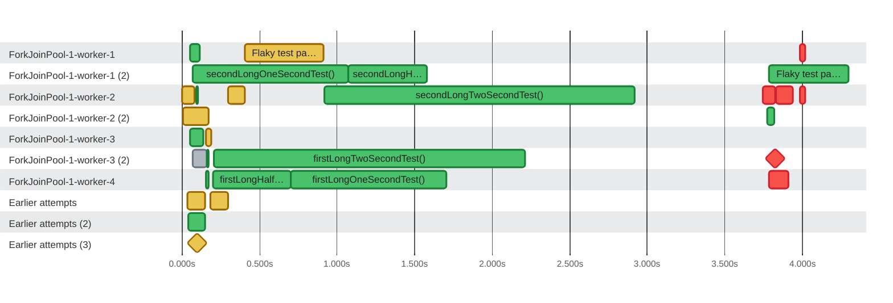

### Timeline

**25** tests and **9** earlier attempts on **10** threads in **4.3s** · busy **22%** of the time · up to **8** at once

🟩 passed · 🟥 failed · 🟨 failed, then retried · ⬜ skipped or other · ♦️ failed too fast for a bar · 0:00 = 2026-10-22 16:06:22 UTC
 6 skipped or pending tests are not shown.
 Tests on <code>ForkJoinPool-1-worker-1</code>, <code>ForkJoinPool-1-worker-2</code>, <code>ForkJoinPool-1-worker-3</code> overlap in time (processes sharing a thread name, or a test timed around others), so they are drawn as several lanes.
 4 earlier attempts overlap other tests on their thread (attempts do not record where they ran), so they are drawn in a lane of their own.
 Tests too short to tell apart are merged into one bar.

| Thread | Tests | Earlier attempts | Failed | Busy | Idle | Utilization |
| :--- | ---: | ---: | ---: | ---: | ---: | ---: |
| ForkJoinPool-1-worker-1 | 4 | 1 | 1 | 605ms | 3.7s | 14% |
| ForkJoinPool-1-worker-1 (2) | 3 | 0 | 0 | 2.0s | 2.3s | 47% |
| ForkJoinPool-1-worker-2 | 6 | 2 | 3 | 2.4s | 1.9s | 56% |
| ForkJoinPool-1-worker-2 (2) | 1 | 1 | 0 | 213ms | 4.1s | 5% |
| ForkJoinPool-1-worker-3 | 2 | 1 | 0 | 107ms | 4.2s | 2% |
| ForkJoinPool-1-worker-3 (2) | 5 | 0 | 2 | 2.2s | 2.1s | 51% |
| ForkJoinPool-1-worker-4 | 4 | 0 | 1 | 1.6s | 2.7s | 38% |
| Earlier attempts | 0 | 2 | 0 | 225ms | 4.1s | 5% |
| Earlier attempts (2) | 0 | 1 | 0 | 106ms | 4.2s | 2% |
| Earlier attempts (3) | 0 | 1 | 0 | 2ms | 4.3s | 0% |

Test timings (34)

| Start | Duration | Thread | Test | Status |
| ---: | ---: | :--- | :--- | :--- |
| 0:00.000 | 79ms | ForkJoinPool-1-worker-2 | initializationError (attempt 1) | ❌ failed |
| 0:00.008 | 165ms | ForkJoinPool-1-worker-2 (2) | teardownError (attempt 1) | ❌ failed |
| 0:00.034 | 114ms | Earlier attempts | usesData(int) (attempt 1) | ❌ failed |
| 0:00.042 | 106ms | Earlier attempts (2) | testBeforeFailingTeardown() (attempt 1) | ✅ passed |
| 0:00.050 | 41ms | ForkJoinPool-1-worker-1 | secondTestTwo() | ✅ passed |
| 0:00.054 | 40ms | ForkJoinPool-1-worker-3 | secondSuccessTest() | ✅ passed |
| 0:00.067 | 90ms | ForkJoinPool-1-worker-3 (2) | requiresUnavailableService() | ⏭️ skipped |
| 0:00.069 | 1.0s | ForkJoinPool-1-worker-1 (2) | secondLongOneSecondTest() | ✅ passed |
| 0:00.089 | 8ms | ForkJoinPool-1-worker-2 | firstTestTwo() | ✅ passed |
| 0:00.091 | 18ms | ForkJoinPool-1-worker-1 | secondTestOne() | ✅ passed |
| 0:00.095 | 2ms | Earlier attempts (3) | initializationError (attempt 1) | ❌ failed |
| 0:00.098 | 3ms | ForkJoinPool-1-worker-2 | firstTestOne() | ✅ passed |
| 0:00.098 | 36ms | ForkJoinPool-1-worker-3 | firstSuccessTest(TestReporter) | ✅ passed |
| 0:00.110 | 6ms | ForkJoinPool-1-worker-1 | refundsTheFee() | ✅ passed |
| 0:00.154 | 17ms | ForkJoinPool-1-worker-4 | refundsEachAmount(int) [2] 2 | ✅ passed |
| 0:00.155 | 31ms | ForkJoinPool-1-worker-3 | factory() (attempt 1) | ❌ failed |
| 0:00.157 | 12ms | ForkJoinPool-1-worker-3 (2) | refundsEachAmount(int) [1] 1 | ✅ passed |
| 0:00.185 | 111ms | Earlier attempts | firstFailedTest() (attempt 1) | ❌ failed |
| 0:00.198 | 503ms | ForkJoinPool-1-worker-4 | firstLongHalfSecondTest() | ✅ passed |
| 0:00.203 | 2.0s | ForkJoinPool-1-worker-3 (2) | firstLongTwoSecondTest() | ✅ passed |
| 0:00.297 | 106ms | ForkJoinPool-1-worker-2 | Second failed test (attempt 1) | ❌ failed |
| 0:00.407 | 507ms | ForkJoinPool-1-worker-1 | Flaky test passed on the second run (attempt 1) | ❌ failed |
| 0:00.702 | 1.0s | ForkJoinPool-1-worker-4 | firstLongOneSecondTest() | ✅ passed |
| 0:00.915 | 2.0s | ForkJoinPool-1-worker-2 | secondLongTwoSecondTest() | ✅ passed |
| 0:01.074 | 503ms | ForkJoinPool-1-worker-1 (2) | secondLongHalfSecondTest() | ✅ passed |
| 0:03.747 | 80ms | ForkJoinPool-1-worker-2 | teardownError | ❌ failed |
| 0:03.762 | 60ms | ForkJoinPool-1-worker-3 (2) | usesData(int) | ❌ failed |
| 0:03.773 | 48ms | ForkJoinPool-1-worker-2 (2) | testBeforeFailingTeardown() | ✅ passed |
| 0:03.784 | 514ms | ForkJoinPool-1-worker-1 (2) | Flaky test passed on the second run | ✅ passed |
| 0:03.785 | 124ms | ForkJoinPool-1-worker-4 | firstFailedTest() | ❌ failed |
| 0:03.823 | 6ms | ForkJoinPool-1-worker-3 (2) | factory() | ❌ failed |
| 0:03.828 | 112ms | ForkJoinPool-1-worker-2 | Second failed test | ❌ failed |
| 0:03.984 | 33ms | ForkJoinPool-1-worker-1 | initializationError | ❌ failed |
| 0:03.984 | 33ms | ForkJoinPool-1-worker-2 | initializationError | ❌ failed |

