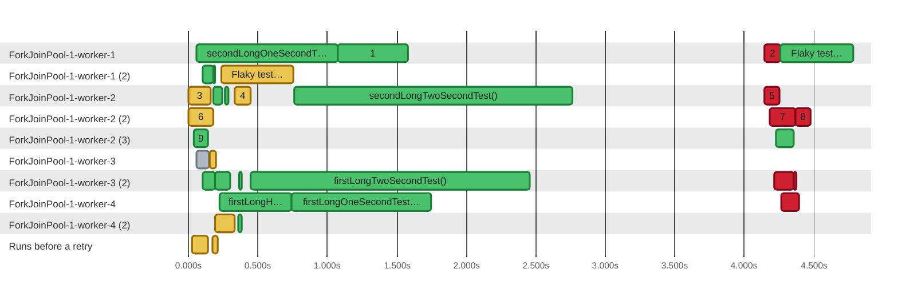

### Timeline

**25** tests (and **9** runs before a retry) on **4** threads in **9** lanes and **1** more lane in **4.8s** · busy **47%** of the time · up to **8** at once Slowest: `secondLongTwoSecondTest()` (2.0s on `ForkJoinPool-1-worker-2`) · Last to finish: `Flaky test passed on the second run` at 0:04.784 on `ForkJoinPool-1-worker-1`

🟩 passed · 🟥 failed · 🟨 failed, then retried (dashed) · ⬜ skipped or other · 0:00 = 2026-10-22 20:48:30.942 UTC
 6 skipped or pending tests are not shown.
 Tests on `ForkJoinPool-1-worker-1`, `ForkJoinPool-1-worker-2`, `ForkJoinPool-1-worker-3` and 1 other thread overlap in time (processes sharing a thread name, or a test timed around others), so they are shown as several lanes.
 2 runs before a retry overlap other tests on their thread (such runs do not record where they ran), so they are shown in a lane of their own.
 A number on a bar is the row with that number (#) in the test timings below.
 Tests too short to tell apart are merged into one bar.

| Thread | Tests | Runs before a retry | Failed | Busy | Idle | Utilization |
| :--- | ---: | ---: | ---: | ---: | ---: | ---: |
| ForkJoinPool-1-worker-1 | 4 | 0 | 1 | 2.2s | 2.6s | 45% |
| ForkJoinPool-1-worker-1 (2) | 2 | 1 | 0 | 610ms | 4.2s | 13% |
| ForkJoinPool-1-worker-2 | 5 | 2 | 1 | 2.5s | 2.3s | 52% |
| ForkJoinPool-1-worker-2 (2) | 2 | 1 | 2 | 467ms | 4.3s | 10% |
| ForkJoinPool-1-worker-2 (3) | 1 | 1 | 0 | 232ms | 4.6s | 5% |
| ForkJoinPool-1-worker-3 | 1 | 1 | 0 | 139ms | 4.6s | 3% |
| ForkJoinPool-1-worker-3 (2) | 6 | 0 | 2 | 2.4s | 2.4s | 50% |
| ForkJoinPool-1-worker-4 | 3 | 0 | 1 | 1.7s | 3.1s | 35% |
| ForkJoinPool-1-worker-4 (2) | 1 | 1 | 0 | 163ms | 4.6s | 3% |
| Runs before a retry | 0 | 2 | 0 | 153ms | 4.6s | 3% |

Test timings (34)

| # | Start | Duration | Thread | Test | Status |
| ---: | ---: | ---: | :--- | :--- | :--- |
|  | 0:00.058 | 1.0s | ForkJoinPool-1-worker-1 | secondLongOneSecondTest() | ✅ passed |
| 1 | 0:01.073 | 504ms | ForkJoinPool-1-worker-1 | secondLongHalfSecondTest() | ✅ passed |
| 2 | 0:04.144 | 117ms | ForkJoinPool-1-worker-1 | initializationError | ❌ failed |
|  | 0:04.260 | 524ms | ForkJoinPool-1-worker-1 | Flaky test passed on the second run | ✅ passed |
|  | 0:00.102 | 77ms | ForkJoinPool-1-worker-1 (2) | secondTestTwo() | ✅ passed |
|  | 0:00.180 | 10ms | ForkJoinPool-1-worker-1 (2) | secondTestOne() | ✅ passed |
|  | 0:00.234 | 523ms | ForkJoinPool-1-worker-1 (2) | Flaky test passed on the second run (attempt 1) | ❌ failed |
| 3 | 0:00.000 | 162ms | ForkJoinPool-1-worker-2 | initializationError (attempt 1) | ❌ failed |
|  | 0:00.181 | 46ms | ForkJoinPool-1-worker-2 | firstTestTwo() | ✅ passed |
|  | 0:00.227 | 19ms | ForkJoinPool-1-worker-2 | firstTestOne() | ✅ passed |
|  | 0:00.264 | 22ms | ForkJoinPool-1-worker-2 | refundsTheFee() | ✅ passed |
| 4 | 0:00.331 | 116ms | ForkJoinPool-1-worker-2 | Second failed test (attempt 1) | ❌ failed |
|  | 0:00.759 | 2.0s | ForkJoinPool-1-worker-2 | secondLongTwoSecondTest() | ✅ passed |
| 5 | 0:04.146 | 109ms | ForkJoinPool-1-worker-2 | initializationError | ❌ failed |
| 6 | 0:00.000 | 176ms | ForkJoinPool-1-worker-2 (2) | teardownError (attempt 1) | ❌ failed |
| 7 | 0:04.184 | 183ms | ForkJoinPool-1-worker-2 (2) | teardownError | ❌ failed |
| 8 | 0:04.371 | 108ms | ForkJoinPool-1-worker-2 (2) | Second failed test | ❌ failed |
| 9 | 0:00.039 | 104ms | ForkJoinPool-1-worker-2 (3) | testBeforeFailingTeardown() (attempt 1) | ✅ passed |
|  | 0:04.228 | 128ms | ForkJoinPool-1-worker-2 (3) | testBeforeFailingTeardown() | ✅ passed |
|  | 0:00.056 | 93ms | ForkJoinPool-1-worker-3 | requiresUnavailableService() | ⏭️ skipped |
|  | 0:00.154 | 46ms | ForkJoinPool-1-worker-3 | factory() (attempt 1) | ❌ failed |
|  | 0:00.101 | 89ms | ForkJoinPool-1-worker-3 (2) | secondSuccessTest() | ✅ passed |
|  | 0:00.191 | 112ms | ForkJoinPool-1-worker-3 (2) | firstSuccessTest(TestReporter) | ✅ passed |
|  | 0:00.364 | 18ms | ForkJoinPool-1-worker-3 (2) | refundsEachAmount(int) \[1\] 1 | ✅ passed |
|  | 0:00.449 | 2.0s | ForkJoinPool-1-worker-3 (2) | firstLongTwoSecondTest() | ✅ passed |
|  | 0:04.214 | 143ms | ForkJoinPool-1-worker-3 (2) | usesData(int) | ❌ failed |
|  | 0:04.360 | 9ms | ForkJoinPool-1-worker-3 (2) | factory() | ❌ failed |
|  | 0:00.223 | 516ms | ForkJoinPool-1-worker-4 | firstLongHalfSecondTest() | ✅ passed |
|  | 0:00.739 | 1.0s | ForkJoinPool-1-worker-4 | firstLongOneSecondTest() | ✅ passed |
|  | 0:04.263 | 132ms | ForkJoinPool-1-worker-4 | firstFailedTest() | ❌ failed |
|  | 0:00.191 | 139ms | ForkJoinPool-1-worker-4 (2) | firstFailedTest() (attempt 1) | ❌ failed |
|  | 0:00.359 | 24ms | ForkJoinPool-1-worker-4 (2) | refundsEachAmount(int) \[2\] 2 | ✅ passed |
|  | 0:00.025 | 118ms | Runs before a retry | usesData(int) (attempt 1) | ❌ failed |
|  | 0:00.173 | 35ms | Runs before a retry | initializationError (attempt 1) | ❌ failed |

