### Timeline

```mermaid
---
config:
  gantt:
    displayMode: compact
    useWidth: 1000
    leftPadding: 97
    rightPadding: 40
  themeCSS: ".taskText.critText0,.taskText.critText1,.taskText.critText2,.taskText.critText3{fill:#ffffff !important}.active0,.active1,.active2,.active3{stroke-dasharray:4 2}"
  themeVariables:
    taskBkgColor: '#4ac26b'
    taskBorderColor: '#1a7f37'
    critBkgColor: '#cf222e'
    critBorderColor: '#82071e'
    activeTaskBkgColor: '#eac54f'
    activeTaskBorderColor: '#9a6700'
    doneTaskBkgColor: '#afb8c1'
    doneTaskBorderColor: '#6e7781'
    taskTextColor: '#1f2328'
    taskTextDarkColor: '#1f2328'
    sectionBkgColor: '#8c959f'
    sectionBkgColor2: '#8c959f'
    vertLineColor: '#8c959f'
---
gantt
accTitle: Test execution timeline
accDescr: 630 tests and 6 earlier attempts on 1 thread over 3m 49s, 0 failed. The slowest test is Two forks of 50,000 tests each, merged into one report, fit the heap (2.5s on Test worker). The last to finish is shouldHandleEmptyTestList() on Test worker, at 3:22:00.806.
dateFormat D HH:mm:ss.SSS
axisFormat %-M:%S
todayMarker off
section ​Test worker
​ :16 00:00:00.000, 0ms
​ :active, milestone, 16 00:00:00.054, 0ms
​ :active, milestone, 16 00:00:25.175, 0ms
​ :16 00:00:31.272, 69ms
​ :16 00:02:51.919, 8ms
​573 tests :16 00:02:58.819, 19374ms
​ :16 00:03:19.628, 1317ms
​ :16 00:03:20.945, 2488ms
​47 tests :16 00:03:23.433, 33192ms
​ :16 00:03:56.625, 0ms
​ :vert, 16 00:02:55.373, 0ms
```

**630** tests and **6** earlier attempts on **1** thread in **3m 49s** · busy **24%** of the time Slowest: `Two forks of 50,000 tests each, merged into one report, fit the heap` (2.5s on `Test worker`) · Last to finish: `shouldHandleEmptyTestList()` at 3:22:00.806 on `Test worker`

🟩 passed · 🟨 failed, then retried (dashed) · ♦️ failed too fast for a bar · 0:00 = 2026-10-21 08:19:12.013 UTC
 1610 results from earlier runs in the same report are not shown: later runs repeated those tests.
 No test ran for 3h 18m, so that stretch is cut out of the chart at the gray line; the tables show real times.
 Tests too short to tell apart are merged into one bar.

Test timings (87 of 636: failed attempts and the slowest)

| Start | Duration | Thread | Test | Status |
| ---: | ---: | :--- | :--- | :--- |
| 0:00:00.000 | 78ms | Test worker | aFailedDynamicContainerIsNamedAfterItsTestFactory() (attempt 1) | ❌ failed |
| 0:00:00.102 | 5ms | Test worker | aRetriedInvocationIsOneFlakyTestUnderItsNewName() (attempt 1) | ❌ failed |
| 0:00:25.124 | 86ms | Test worker | aFailedDynamicContainerIsNamedAfterItsTestFactory() (attempt 2) | ❌ failed |
| 0:00:25.225 | 1ms | Test worker | aRetriedInvocationIsOneFlakyTestUnderItsNewName() (attempt 2) | ❌ failed |
| 0:00:31.272 | 50ms | Test worker | aFailedDynamicContainerIsNamedAfterItsTestFactory() (attempt 3) | ✅ passed |
| 3:21:03.000 | 51ms | Test worker | Each attempt keeps its own attachments through folding and unfolding | ✅ passed |
| 3:21:03.103 | 844ms | Test worker | testGenerateCtrfJsonWithUnhealthyEnvironment() | ✅ passed |
| 3:21:04.354 | 84ms | Test worker | Review Focus 2: non-ASCII text longer than the read buffers is read back whole | ✅ passed |
| 3:21:04.439 | 116ms | Test worker | A report given as a bare file name, as the default ctrf-report.json is, is written in the working directory | ✅ passed |
| 3:21:04.575 | 27ms | Test worker | update with a null runId throws, and leaves the report as it was | ✅ passed |
| 3:21:04.634 | 26ms | Test worker | When the report's own directory can't be written, the earlier report stays as it was and nothing is thrown | ✅ passed |
| 3:21:04.743 | 42ms | Test worker | update passes the current report to the merge function and writes what it returns | ✅ passed |
| 3:21:04.812 | 67ms | Test worker | update creates missing directories and writes the report, with its lock file next to it | ✅ passed |
| 3:21:04.885 | 73ms | Test worker | Updates from many threads at once all land | ✅ passed |
| 3:21:04.968 | 339ms | Test worker | When another holder keeps the lock, update waits for the timeout and then writes without it | ✅ passed |
| 3:21:05.340 | 950ms | Test worker | A move that keeps failing is retried for about a second, then reported, leaving no temp file | ✅ passed |
| 3:21:06.297 | 662ms | Test worker | Of threads finishing the same run at once, exactly one writes the report, round after round | ✅ passed |
| 3:21:06.959 | 128ms | Test worker | Tests started and finished on many threads at once are each reported once, with their status | ✅ passed |
| 3:21:07.090 | 143ms | Test worker | A failed test gets the output JUnit captured for it | ✅ passed |
| 3:21:07.266 | 52ms | Test worker | An unhealthy report of the same run keeps the merged report unhealthy | ✅ passed |
| 3:21:07.396 | 146ms | Test worker | A non-numeric build number is written as buildId, and the report has no schema errors | ✅ passed |
| 3:21:07.606 | 43ms | Test worker | The static methods mark and read the health of the JVM's default manager | ✅ passed |
| 3:21:07.802 | 38ms | Test worker | Should extract unique ID from TestIdentifier | ✅ passed |
| 3:21:07.859 | 30ms | Test worker | Under a suite engine, every engine is left out, and the @⁠Suite class stays | ✅ passed |
| 3:21:07.908 | 56ms | Test worker | MP-13: a test that a test method creates is named after the method | ✅ passed |
| 3:21:08.021 | 99ms | Test worker | An identifier whose ancestors the plan can't give has no suite, and doesn't throw | ✅ passed |
| 3:21:08.192 | 34ms | Test worker | summaryWritesItsDuration() | ✅ passed |
| 3:21:08.337 | 42ms | Test worker | readerReadsTheGoldenJsonAsJacksonDoes(String, Object, String) "full-report" | ✅ passed |
| 3:21:08.384 | 118ms | Test worker | readerReadsALargeGeneratedReportAsJacksonDoes() | ✅ passed |
| 3:21:08.595 | 33ms | Test worker | exitHook\_afterTheRunFinished\_doesNothing() | ✅ passed |
| 3:21:08.685 | 231ms | Test worker | exitHook\_waitsForTheCallbackInProgressAndTheCallbacksAfterItRecordNothing() | ✅ passed |
| 3:21:08.964 | 33ms | Test worker | fromAdapter\_takesTheAdaptersSuite() | ✅ passed |
| 3:21:09.001 | 899ms | Test worker | listenerReportsAFailedAssumptionAsSkipped() | ✅ passed |
| 3:21:09.900 | 2.0s | Test worker | eachAttemptKeepsItsOwnFileWhenEachJvmWritesToItsOwnDirectory() | ✅ passed |
| 3:21:11.912 | 661ms | Test worker | fileThatAClassPublishedBeforeItsSetupFailedIsAttachedToItsInitializationError() | ✅ passed |
| 3:21:12.573 | 529ms | Test worker | screenshotThatATestWatcherPublishesForAFailedTestIsAttachedToIt() | ✅ passed |
| 3:21:13.102 | 617ms | Test worker | publishedFilesAreAttachedToTheirTests() | ✅ passed |
| 3:21:13.720 | 582ms | Test worker | ctrfEnvironmentVariablesConfigureTheReport() | ✅ passed |
| 3:21:14.302 | 694ms | Test worker | listenerReportsAfterAllFailureOfAClassWhoseTestsWereSkippedAsTeardownError() | ✅ passed |
| 3:21:14.997 | 593ms | Test worker | listenerReportsFailedParameterizedAndFactoryContainers() | ✅ passed |
| 3:21:15.590 | 940ms | Test worker | listenerFailedCountMatchesJunitFailedTestsPlusFailedContainers() | ✅ passed |
| 3:21:16.530 | 931ms | Test worker | listenerReportsAfterAllFailureAsTeardownError() | ✅ passed |
| 3:21:17.462 | 1.3s | Test worker | listenerReportsATeardownFailureThatRecoversAsPassedAndFlaky() | ✅ passed |
| 3:21:18.738 | 1.2s | Test worker | listenerReportsATeardownFailureInEveryRoundAsFailed() | ✅ passed |
| 3:21:19.977 | 1.0s | Test worker | listenerReportsASetupFailureThatRecoversAsPassedAndFlaky() | ✅ passed |
| 3:21:21.022 | 1.4s | Test worker | listenerReportsASetupFailureInEveryRoundAsFailed() | ✅ passed |
| 3:21:23.812 | 1.3s | Test worker | A first write of 100,000 tests fits the heap | ✅ passed |
| 3:21:25.126 | 2.5s | Test worker | Two forks of 50,000 tests each, merged into one report, fit the heap | ✅ passed |
| 3:21:27.614 | 2.1s | Test worker | A rerun that replaces another run's report of 100,000 tests fits the heap | ✅ passed |
| 3:21:29.668 | 580ms | Test worker | exitInAClassSetupAddsAnEntryForTheClass() | ✅ passed |
| 3:21:30.248 | 543ms | Test worker | classWhoseSetupFailedBeforeTheExitKeepsOnlyItsInitializationError() | ✅ passed |
| 3:21:30.791 | 648ms | Test worker | exitInAParameterSourceAddsAnEntryForTheParameterizedTest() | ✅ passed |
| 3:21:31.440 | 692ms | Test worker | jvmTerminatedMidTestReportsTheTestAsOther() | ✅ passed |
| 3:21:32.132 | 549ms | Test worker | jvmThatExitsMidRunReportsItsTests() | ✅ passed |
| 3:21:32.681 | 843ms | Test worker | forkThatExitsMidRunKeepsItsTestsBesideTheOtherForks() | ✅ passed |
| 3:21:33.525 | 891ms | Test worker | secondListenerOnTheSameLauncherReportsNothing() | ✅ passed |
| 3:21:34.416 | 594ms | Test worker | junitsDeactivateSettingTurnsTheListenerOff() | ✅ passed |
| 3:21:35.010 | 906ms | Test worker | listenerRegisteredByHandAsWellReportsEachTestOnce() | ✅ passed |
| 3:21:35.916 | 483ms | Test worker | jarRegistersTheListenerItself() | ✅ passed |
| 3:21:36.399 | 824ms | Test worker | nestedRunThroughTheListenerNeitherEndsTheRunNorAddsItsTests() | ✅ passed |
| 3:21:37.224 | 1.2s | Test worker | listenerReportsEveryTestOnceUnderParallelExecution() | ✅ passed |
| 3:21:38.466 | 958ms | Test worker | forksOfOneRunFinishingTogetherAllLandInOneReport() | ✅ passed |
| 3:21:39.424 | 1.8s | Test worker | newBuildReplacesTheReportOfAnEarlierBuild() | ✅ passed |
| 3:21:41.270 | 1.1s | Test worker | newCiRunReplacesTheReportOfAnEarlierCiRun() | ✅ passed |
| 3:21:42.353 | 1.2s | Test worker | sameCiRunMergesItsJvms() | ✅ passed |
| 3:21:43.580 | 570ms | Test worker | secondExecutionInTheSameJvmKeepsTheFirstExecutionsResults() | ✅ passed |
| 3:21:44.151 | 1.2s | Test worker | listenerFoldsRetryRoundsIntoOneEntryPerTest() | ✅ passed |
| 3:21:45.356 | 1.8s | Test worker | listenerExtendsTheHistoryInAThirdRound() | ✅ passed |
| 3:21:47.161 | 639ms | Test worker | listenerReportsDisabledTestMethodsWhoseTestsJunitCreatesOnlyWhileRunningThem() | ✅ passed |
| 3:21:47.800 | 578ms | Test worker | listenerReportsEachTestOfAnAbortedClassAsSkippedWithTheAssumptionMessage() | ✅ passed |
| 3:21:48.378 | 413ms | Test worker | listenerReportsEachTestOfADisabledClassWithTheClassReason() | ✅ passed |
| 3:21:48.792 | 787ms | Test worker | listenerCountsMatchJunitWhenWholeClassesAreSkipped() | ✅ passed |
| 3:21:49.580 | 766ms | Test worker | listenerReportsTestsOfADisabledNestedClassOnceWhenTheOuterClassAbortsLater() | ✅ passed |
| 3:21:50.346 | 485ms | Test worker | listenerReportsEachTestOfAConditionallySkippedClassWithTheConditionReason() | ✅ passed |
| 3:21:50.831 | 934ms | Test worker | listenerDoesNotReportTestMethodsThatAlreadyRanAsSkippedWhenTheirClassAbortsLater() | ✅ passed |
| 3:21:51.765 | 570ms | Test worker | listenerReportsATestSkippedOnItsOwnOnceWhenItsClassAbortsLater() | ✅ passed |
| 3:21:52.335 | 688ms | Test worker | listenerReportsATemplateMethodOfADisabledClassAsSkipped() | ✅ passed |
| 3:21:53.023 | 585ms | Test worker | listenerReportsAFailedContainerOnlyAsFailedWhenItsClassAbortsLater() | ✅ passed |
| 3:21:53.609 | 776ms | Test worker | listenerGroupsClassErrorsAndTestsOfASkippedClassUnderTheirClass() | ✅ passed |
| 3:21:54.386 | 932ms | Test worker | listenerGroupsEveryEntryByItsContainers() | ✅ passed |
| 3:21:55.319 | 426ms | Test worker | everyReportedTestCarriesItsJunitUniqueIdAsTestId() | ✅ passed |
| 3:21:55.746 | 742ms | Test worker | testsSharingDisplayNamesWithFailedTestsInAnotherClassAreNotRetries() | ✅ passed |
| 3:21:56.488 | 588ms | Test worker | passingTestsWithTheSameMethodNameInTwoClassesAreNotFlaky() | ✅ passed |
| 3:21:57.076 | 611ms | Test worker | outputOfAFailedClassSetupGoesToItsInitializationError() | ✅ passed |
| 3:21:57.688 | 467ms | Test worker | withoutCaptureThereIsNoOutput() | ✅ passed |
| 3:21:58.156 | 1.9s | Test worker | eachAttemptKeepsItsOwnOutput() | ✅ passed |
| 3:22:00.048 | 757ms | Test worker | failedTestKeepsItsCapturedOutputAndAPassedOneDropsIt() | ✅ passed |

