### Timeline

**627** tests on **1** thread in **57.8s** · busy **97%** of the time

```mermaid
---
config:
  gantt:
    displayMode: compact
    useWidth: 1000
    leftPadding: 95
    rightPadding: 40
  themeVariables:
    taskBkgColor: '#4ac26b'
    taskBorderColor: '#1a7f37'
    critBkgColor: '#f85149'
    critBorderColor: '#cf222e'
    activeTaskBkgColor: '#eac54f'
    activeTaskBorderColor: '#9a6700'
    doneTaskBkgColor: '#afb8c1'
    doneTaskBorderColor: '#6e7781'
    taskTextColor: '#1f2328'
    taskTextDarkColor: '#1f2328'
    sectionBkgColor: '#8c959f'
    sectionBkgColor2: '#8c959f'
---
gantt
accTitle: Test execution timeline
accDescr: 627 tests on 1 thread over 57.8s, 0 failed
dateFormat D HH:mm:ss.SSS
axisFormat %-M:%S
todayMarker off
section ​Test worker
​ :16 00:00:00.000, 99ms
​ :16 00:00:00.103, 844ms
​ :16 00:00:00.949, 216ms
​ :16 00:00:01.354, 986ms
​ :16 00:00:02.340, 950ms
​ :16 00:00:03.290, 3ms
​ :16 00:00:03.297, 662ms
​ :16 00:00:03.959, 2042ms
​ :16 00:00:06.001, 899ms
​ :16 00:00:06.900, 2011ms
​ :16 00:00:08.912, 661ms
​ :16 00:00:09.573, 529ms
​ :16 00:00:10.102, 617ms
​ :16 00:00:10.720, 582ms
​ :16 00:00:11.302, 694ms
​ :16 00:00:11.997, 593ms
​ :16 00:00:12.590, 940ms
​ :16 00:00:13.530, 931ms
​ :16 00:00:14.462, 1276ms
​ :16 00:00:15.738, 1239ms
​ :16 00:00:16.977, 1045ms
​ :16 00:00:18.022, 1352ms
​ :16 00:00:20.809, 2ms
​ :16 00:00:20.812, 1314ms
​ :16 00:00:22.126, 2488ms
​ :16 00:00:24.614, 2054ms
​ :16 00:00:26.668, 580ms
​ :16 00:00:27.248, 543ms
​ :16 00:00:27.791, 648ms
​ :16 00:00:28.440, 692ms
​ :16 00:00:29.132, 549ms
​ :16 00:00:29.681, 843ms
​ :16 00:00:30.525, 891ms
​ :16 00:00:31.416, 594ms
​ :16 00:00:32.010, 906ms
​ :16 00:00:32.916, 483ms
​ :16 00:00:33.399, 824ms
​ :16 00:00:34.224, 1242ms
​ :16 00:00:35.466, 958ms
​ :16 00:00:36.424, 1846ms
​ :16 00:00:38.270, 1083ms
​ :16 00:00:39.353, 1227ms
​ :16 00:00:40.580, 570ms
​ :16 00:00:41.151, 1204ms
​ :16 00:00:42.356, 1798ms
​ :16 00:00:44.155, 6ms
​ :16 00:00:44.161, 639ms
​ :16 00:00:44.800, 578ms
​ :16 00:00:45.378, 413ms
​ :16 00:00:45.792, 787ms
​ :16 00:00:46.580, 766ms
​ :16 00:00:47.346, 485ms
​ :16 00:00:47.831, 934ms
​ :16 00:00:48.765, 570ms
​ :16 00:00:49.335, 688ms
​ :16 00:00:50.023, 585ms
​ :16 00:00:50.609, 776ms
​ :16 00:00:51.386, 932ms
​ :16 00:00:52.319, 426ms
​ :16 00:00:52.746, 742ms
​ :16 00:00:53.488, 588ms
​ :16 00:00:54.076, 611ms
​ :16 00:00:54.688, 467ms
​ :16 00:00:55.156, 1892ms
​ :16 00:00:57.048, 757ms
​ :16 00:00:57.805, 1ms
```

🟩 passed · 0:00 = 2026-10-21 11:40:15 UTC
 3 tests and 1616 earlier attempts from another run in the same report are not shown: they ran 3h 7m or more before or after these.
 Tests too short to tell apart are merged into one bar.

Test timings (81 of 627: failures, retries and the slowest)

| Start | Duration | Thread | Test | Status |
| ---: | ---: | :--- | :--- | :--- |
| 0:00.000 | 51ms | Test worker | Each attempt keeps its own attachments through folding and unfolding | ✅ passed |
| 0:00.103 | 844ms | Test worker | testGenerateCtrfJsonWithUnhealthyEnvironment() | ✅ passed |
| 0:01.354 | 84ms | Test worker | Review Focus 2: non-ASCII text longer than the read buffers is read back whole | ✅ passed |
| 0:01.439 | 116ms | Test worker | A report given as a bare file name, as the default ctrf-report.json is, is written in the working directory | ✅ passed |
| 0:01.575 | 27ms | Test worker | update with a null runId throws, and leaves the report as it was | ✅ passed |
| 0:01.743 | 42ms | Test worker | update passes the current report to the merge function and writes what it returns | ✅ passed |
| 0:01.812 | 67ms | Test worker | update creates missing directories and writes the report, with its lock file next to it | ✅ passed |
| 0:01.885 | 73ms | Test worker | Updates from many threads at once all land | ✅ passed |
| 0:01.968 | 339ms | Test worker | When another holder keeps the lock, update waits for the timeout and then writes without it | ✅ passed |
| 0:02.340 | 950ms | Test worker | A move that keeps failing is retried for about a second, then reported, leaving no temp file | ✅ passed |
| 0:03.297 | 662ms | Test worker | Of threads finishing the same run at once, exactly one writes the report, round after round | ✅ passed |
| 0:03.959 | 128ms | Test worker | Tests started and finished on many threads at once are each reported once, with their status | ✅ passed |
| 0:04.090 | 143ms | Test worker | A failed test gets the output JUnit captured for it | ✅ passed |
| 0:04.266 | 52ms | Test worker | An unhealthy report of the same run keeps the merged report unhealthy | ✅ passed |
| 0:04.396 | 146ms | Test worker | A non-numeric build number is written as buildId, and the report has no schema errors | ✅ passed |
| 0:04.606 | 43ms | Test worker | The static methods mark and read the health of the JVM&#x27;s default manager | ✅ passed |
| 0:04.802 | 38ms | Test worker | Should extract unique ID from TestIdentifier | ✅ passed |
| 0:04.859 | 30ms | Test worker | Under a suite engine, every engine is left out, and the @Suite class stays | ✅ passed |
| 0:04.908 | 56ms | Test worker | MP-13: a test that a test method creates is named after the method | ✅ passed |
| 0:05.021 | 99ms | Test worker | An identifier whose ancestors the plan can&#x27;t give has no suite, and doesn&#x27;t throw | ✅ passed |
| 0:05.192 | 34ms | Test worker | summaryWritesItsDuration() | ✅ passed |
| 0:05.337 | 42ms | Test worker | readerReadsTheGoldenJsonAsJacksonDoes(String, Object, String) &quot;full-report&quot; | ✅ passed |
| 0:05.384 | 118ms | Test worker | readerReadsALargeGeneratedReportAsJacksonDoes() | ✅ passed |
| 0:05.595 | 33ms | Test worker | exitHook_afterTheRunFinished_doesNothing() | ✅ passed |
| 0:05.685 | 231ms | Test worker | exitHook_waitsForTheCallbackInProgressAndTheCallbacksAfterItRecordNothing() | ✅ passed |
| 0:05.964 | 33ms | Test worker | fromAdapter_takesTheAdaptersSuite() | ✅ passed |
| 0:06.001 | 899ms | Test worker | listenerReportsAFailedAssumptionAsSkipped() | ✅ passed |
| 0:06.900 | 2.0s | Test worker | eachAttemptKeepsItsOwnFileWhenEachJvmWritesToItsOwnDirectory() | ✅ passed |
| 0:08.912 | 661ms | Test worker | fileThatAClassPublishedBeforeItsSetupFailedIsAttachedToItsInitializationError() | ✅ passed |
| 0:09.573 | 529ms | Test worker | screenshotThatATestWatcherPublishesForAFailedTestIsAttachedToIt() | ✅ passed |
| 0:10.102 | 617ms | Test worker | publishedFilesAreAttachedToTheirTests() | ✅ passed |
| 0:10.720 | 582ms | Test worker | ctrfEnvironmentVariablesConfigureTheReport() | ✅ passed |
| 0:11.302 | 694ms | Test worker | listenerReportsAfterAllFailureOfAClassWhoseTestsWereSkippedAsTeardownError() | ✅ passed |
| 0:11.997 | 593ms | Test worker | listenerReportsFailedParameterizedAndFactoryContainers() | ✅ passed |
| 0:12.590 | 940ms | Test worker | listenerFailedCountMatchesJunitFailedTestsPlusFailedContainers() | ✅ passed |
| 0:13.530 | 931ms | Test worker | listenerReportsAfterAllFailureAsTeardownError() | ✅ passed |
| 0:14.462 | 1.3s | Test worker | listenerReportsATeardownFailureThatRecoversAsPassedAndFlaky() | ✅ passed |
| 0:15.738 | 1.2s | Test worker | listenerReportsATeardownFailureInEveryRoundAsFailed() | ✅ passed |
| 0:16.977 | 1.0s | Test worker | listenerReportsASetupFailureThatRecoversAsPassedAndFlaky() | ✅ passed |
| 0:18.022 | 1.4s | Test worker | listenerReportsASetupFailureInEveryRoundAsFailed() | ✅ passed |
| 0:20.812 | 1.3s | Test worker | A first write of 100,000 tests fits the heap | ✅ passed |
| 0:22.126 | 2.5s | Test worker | Two forks of 50,000 tests each, merged into one report, fit the heap | ✅ passed |
| 0:24.614 | 2.1s | Test worker | A rerun that replaces another run&#x27;s report of 100,000 tests fits the heap | ✅ passed |
| 0:26.668 | 580ms | Test worker | exitInAClassSetupAddsAnEntryForTheClass() | ✅ passed |
| 0:27.248 | 543ms | Test worker | classWhoseSetupFailedBeforeTheExitKeepsOnlyItsInitializationError() | ✅ passed |
| 0:27.791 | 648ms | Test worker | exitInAParameterSourceAddsAnEntryForTheParameterizedTest() | ✅ passed |
| 0:28.440 | 692ms | Test worker | jvmTerminatedMidTestReportsTheTestAsOther() | ✅ passed |
| 0:29.132 | 549ms | Test worker | jvmThatExitsMidRunReportsItsTests() | ✅ passed |
| 0:29.681 | 843ms | Test worker | forkThatExitsMidRunKeepsItsTestsBesideTheOtherForks() | ✅ passed |
| 0:30.525 | 891ms | Test worker | secondListenerOnTheSameLauncherReportsNothing() | ✅ passed |
| 0:31.416 | 594ms | Test worker | junitsDeactivateSettingTurnsTheListenerOff() | ✅ passed |
| 0:32.010 | 906ms | Test worker | listenerRegisteredByHandAsWellReportsEachTestOnce() | ✅ passed |
| 0:32.916 | 483ms | Test worker | jarRegistersTheListenerItself() | ✅ passed |
| 0:33.399 | 824ms | Test worker | nestedRunThroughTheListenerNeitherEndsTheRunNorAddsItsTests() | ✅ passed |
| 0:34.224 | 1.2s | Test worker | listenerReportsEveryTestOnceUnderParallelExecution() | ✅ passed |
| 0:35.466 | 958ms | Test worker | forksOfOneRunFinishingTogetherAllLandInOneReport() | ✅ passed |
| 0:36.424 | 1.8s | Test worker | newBuildReplacesTheReportOfAnEarlierBuild() | ✅ passed |
| 0:38.270 | 1.1s | Test worker | newCiRunReplacesTheReportOfAnEarlierCiRun() | ✅ passed |
| 0:39.353 | 1.2s | Test worker | sameCiRunMergesItsJvms() | ✅ passed |
| 0:40.580 | 570ms | Test worker | secondExecutionInTheSameJvmKeepsTheFirstExecutionsResults() | ✅ passed |
| 0:41.151 | 1.2s | Test worker | listenerFoldsRetryRoundsIntoOneEntryPerTest() | ✅ passed |
| 0:42.356 | 1.8s | Test worker | listenerExtendsTheHistoryInAThirdRound() | ✅ passed |
| 0:44.161 | 639ms | Test worker | listenerReportsDisabledTestMethodsWhoseTestsJunitCreatesOnlyWhileRunningThem() | ✅ passed |
| 0:44.800 | 578ms | Test worker | listenerReportsEachTestOfAnAbortedClassAsSkippedWithTheAssumptionMessage() | ✅ passed |
| 0:45.378 | 413ms | Test worker | listenerReportsEachTestOfADisabledClassWithTheClassReason() | ✅ passed |
| 0:45.792 | 787ms | Test worker | listenerCountsMatchJunitWhenWholeClassesAreSkipped() | ✅ passed |
| 0:46.580 | 766ms | Test worker | listenerReportsTestsOfADisabledNestedClassOnceWhenTheOuterClassAbortsLater() | ✅ passed |
| 0:47.346 | 485ms | Test worker | listenerReportsEachTestOfAConditionallySkippedClassWithTheConditionReason() | ✅ passed |
| 0:47.831 | 934ms | Test worker | listenerDoesNotReportTestMethodsThatAlreadyRanAsSkippedWhenTheirClassAbortsLater() | ✅ passed |
| 0:48.765 | 570ms | Test worker | listenerReportsATestSkippedOnItsOwnOnceWhenItsClassAbortsLater() | ✅ passed |
| 0:49.335 | 688ms | Test worker | listenerReportsATemplateMethodOfADisabledClassAsSkipped() | ✅ passed |
| 0:50.023 | 585ms | Test worker | listenerReportsAFailedContainerOnlyAsFailedWhenItsClassAbortsLater() | ✅ passed |
| 0:50.609 | 776ms | Test worker | listenerGroupsClassErrorsAndTestsOfASkippedClassUnderTheirClass() | ✅ passed |
| 0:51.386 | 932ms | Test worker | listenerGroupsEveryEntryByItsContainers() | ✅ passed |
| 0:52.319 | 426ms | Test worker | everyReportedTestCarriesItsJunitUniqueIdAsTestId() | ✅ passed |
| 0:52.746 | 742ms | Test worker | testsSharingDisplayNamesWithFailedTestsInAnotherClassAreNotRetries() | ✅ passed |
| 0:53.488 | 588ms | Test worker | passingTestsWithTheSameMethodNameInTwoClassesAreNotFlaky() | ✅ passed |
| 0:54.076 | 611ms | Test worker | outputOfAFailedClassSetupGoesToItsInitializationError() | ✅ passed |
| 0:54.688 | 467ms | Test worker | withoutCaptureThereIsNoOutput() | ✅ passed |
| 0:55.156 | 1.9s | Test worker | eachAttemptKeepsItsOwnOutput() | ✅ passed |
| 0:57.048 | 757ms | Test worker | failedTestKeepsItsCapturedOutputAndAPassedOneDropsIt() | ✅ passed |

