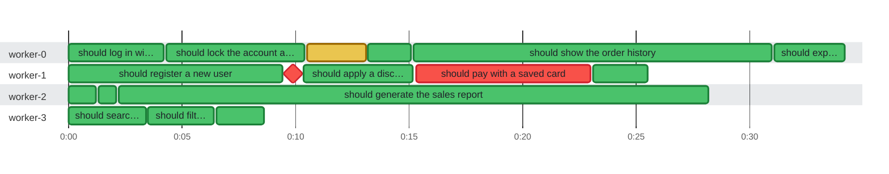

### Timeline

**16** tests and **1** earlier attempt on **4** threads in **34.2s** · busy **70%** of the time · up to **4** at once

🟩 passed · 🟥 failed · 🟨 failed, then retried · ♦️ failed too fast for a bar · 0:00 = 2026-01-01 08:00:00 UTC
 1 skipped or pending test is not shown.

| Thread | Tests | Earlier attempts | Failed | Busy | Idle | Utilization |
| :--- | ---: | ---: | ---: | ---: | ---: | ---: |
| worker-0 | 5 | 1 | 0 | 33.7s | 500ms | 99% |
| worker-1 | 5 | 0 | 2 | 25.1s | 9.1s | 73% |
| worker-2 | 3 | 0 | 0 | 28.0s | 6.2s | 82% |
| worker-3 | 3 | 0 | 0 | 8.4s | 25.8s | 25% |

Test timings (17)

| Start | Duration | Thread | Test | Status |
| ---: | ---: | :--- | :--- | :--- |
| 0:00.000 | 4.2s | worker-0 | should log in with valid credentials | ✅ passed |
| 0:00.000 | 9.8s | worker-1 | should register a new user | ✅ passed |
| 0:00.000 | 1.2s | worker-2 | should keep the cart after reload | ✅ passed |
| 0:00.000 | 3.4s | worker-3 | should search by product name | ✅ passed |
| 0:01.300 | 800ms | worker-2 | should update the cart badge | ✅ passed |
| 0:02.200 | 26.0s | worker-2 | should generate the sales report | ✅ passed |
| 0:03.500 | 2.9s | worker-3 | should filter by price | ✅ passed |
| 0:04.300 | 6.1s | worker-0 | should lock the account after 3 failures | ✅ passed |
| 0:06.500 | 2.1s | worker-3 | should sort by rating | ✅ passed |
| 0:09.900 | 0ms | worker-1 | should open the checkout page | ❌ failed |
| 0:09.950 | 5.2s | worker-1 | should apply a discount code | ✅ passed |
| 0:10.500 | 2.6s | worker-0 | should reset the password by email (attempt 1) | ❌ failed |
| 0:13.200 | 1.9s | worker-0 | should reset the password by email | ✅ passed |
| 0:15.200 | 15.8s | worker-0 | should show the order history | ✅ passed |
| 0:15.300 | 7.7s | worker-1 | should pay with a saved card | ❌ failed |
| 0:23.100 | 2.4s | worker-1 | should send the receipt | ✅ passed |
| 0:31.100 | 3.1s | worker-0 | should export orders as CSV | ✅ passed |

